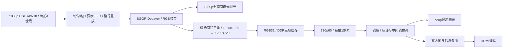

# 固定比例面积平均：1080p采集 / 720p60显示

本工作区为 `Ti60f225_soc_cam_hdmi_720p`，分支 `feature/video-720p`，从 `bf47dfa3674ac3cc534c28b43348447740cc7fc7` 开始。参考相邻 `Ti60f225_soc_hdmi_720p` 工作区的面积平均实现，保留本分支原有自动曝光、高光保护、调色、自动/手动提亮、显示测光和HDMI直方图。Gamma保持删除；尚未集成CPU，字符渲染仍为占位接口。



摄像头初始化保持1920×1080 RAW10。两个方向均以2/3比例缩放：每三个水平输入 `a,b,c` 生成 `2a+b` 和 `b+2c`，垂直方向同样加权，最后统一 `(sum+4)/9` 舍入。每3×3区域映射为2×2像素，权重核为：

```text
4 2 0     0 2 4     0 0 0     0 0 0
2 1 0     0 1 2     2 1 0     0 1 2
0 0 0     0 0 0     4 2 0     0 2 4
```

全部核除以9，无中间截断。行缓存保存水平加权和，分成两个银行；除以9使用四级比较/减法流水线，缩放器不使用DSP。RAW适配器先缓存完整行再连续输出，避免原Debayer把输入空拍误判为换行。

| 项目 | 本分支配置 |
| --- | --- |
| 传感器输入 | 1920×1080，RAW10高8位，4 lane |
| 采集处理 | `vid_clk_dvi2` 148.5MHz，每拍2像素 |
| DDR写入 | 64位，每行640拍，共720行 |
| DDR读取 | 32位，每行1280拍，共720行 |
| DDR像素布局 | `0x00BBGGRR`，R[7:0]、G[15:8]、B[23:16]；一对中先到像素在[63:32] |
| HDMI水平时序 | 1280 / 前沿110 / 同步40 / 后沿220；总1650 |
| HDMI垂直时序 | 720 / 前沿5 / 同步5 / 后沿20；总750 |
| HDMI时钟 | 像素74.25MHz，串行371.25MHz，DDR输出742.5Mb/s/lane |
| HDMI格式 | RGB，VIC=4；当前音频有效信号为0 |
| 曝光测光 | 缩放前1080p全画面，每帧32,400个样本 |
| 显示测光 / 直方图 | 提亮后、叠加前720p全画面，每帧7,200个样本 |

DDR单帧数据为3,686,400字节，三帧为11,059,200字节，约10.55MiB（另考虑地址对齐）。原版本保存1080p RAW8，本版保存720p RGB32，因此分辨率下降并不意味着DDR容量或带宽下降。单路720p60读流约221.184MB/s；若采集也为60fps，读写数据合计约442.368MB/s，不含总线开销。传感器实际帧率需上板确认。

帧缓冲同步迁入尺寸参数传递、帧长稳定性检查、SOF跨时钟toggle、水位位宽和DMA复位修复。视频复位等待DDR校准及PLL锁定，并在CSI、采集、显示时钟域分别同步释放。复位后的残帧被丢弃；FIFO溢出或非法帧故障锁存，需要复位恢复。

LED0保留校准/心跳；LED1为RAW采集故障，LED2为缩放故障，LED3为显示欠流锁存，LED7:4为完成缩放帧数的低4位。USER1的旧名 `ch0_g/ch0_b` 探针现在分别接采集RAW低/高字节，`ch0_de/ch0_vs` 接采集有效/帧同步，采样时钟148.5MHz；RGB增益与AE等VIO接口保留。加载本工作区配套 `debug.json`。

## 验证与编译

```powershell
python tools/check_rtl_config.py
python tools/test_resize.py
python tools/run_rtl_checks.py
C:/Efinity/2026.1/bin/efx_run.bat ti60f225_cam_hdmi.xml --flow compile --timeout 1200
```

`tools/test_resize.py` 使用独立面积重叠参考逐像素比较随机完整1080p帧及白/黑/棋盘/斜坡/脉冲小帧；还覆盖异步CSI完整帧、启动残帧、除法舍入、故障、DDR停顿/4KB跨界/三帧地址/像素顺序及完整720p时序。完整CSI两帧仿真允许1,200秒墙钟时间；并行运行综合或仿真时会更慢。快速控制检查可运行 `tools/test_resize_checks.py`。输出和大型仿真向量在忽略目录 `reports/simulation/`。

原有回归追加两帧完整720p叠加，确认每帧7,200个直方图样本，保留1080p及小尺寸复用测试。配置继续集中在 `rtl/defines.v`，详细宏审计见 `RTL_CONFIG_README.md`。

下载文件为本目录 `outflow/ti60f225_oob.bit`，工程入口 `ti60f225_cam_hdmi.xml`。资源、编译及受约束时序结果见 `../reports/archive/legacy-documents/720p-pre-soc_RESOURCE_USAGE_REPORT.md`。编译和仿真不能替代上板验证，本次未下载硬件。
