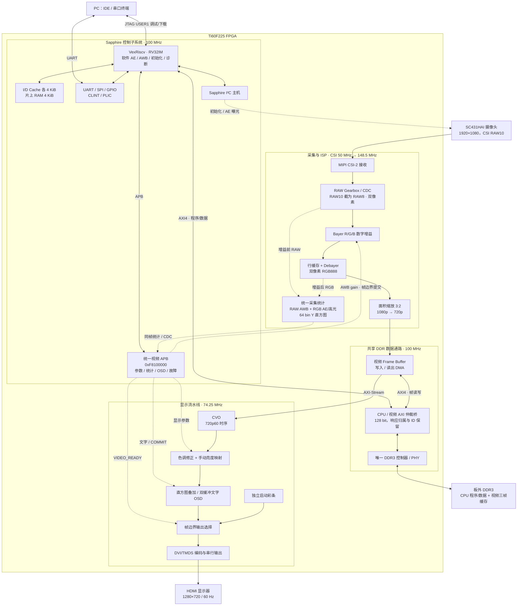
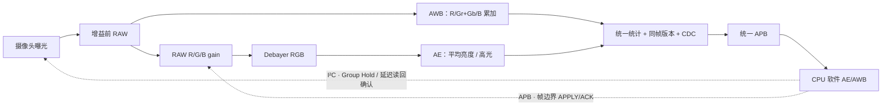
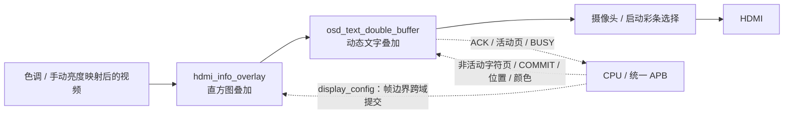

# 当前 SoC 框图

核对日期：2026-10-09。对应当前统一APB与SoC清理源码；新硬件产物记录见`reports/soc_cleanup/README.md`。旧硬件AE、旧I²C主机与无效OSD/状态mailbox已从当前顶层移除，CPU独占摄像头I²C。虚线表示控制或统计反馈，实线表示主要数据/总线连接。

CPU主固件链接在DDR地址`0x00001000`，不是片上RAM；独立片上RAM位于`0xF9000000`，容量4 KiB。CPU DDR scratch预留窗口起始`0x01000000`，视频三帧缓存基址`0x04000000`。DDR参数与地址范围以当前RTL/链接脚本为准。

## AE / AWB 闭环

AWB为增益前RAW灰度世界，默认AUTO；中性色筛选硬件存在但默认关闭，单色场景自动保护尚未实现。AE使用增益后、缩放前RGB测光。显示端另有亮度统计与绘图直方图；自动lift关闭，手动lift启用。软件直方图快照默认不开启，显示直方图默认关闭。

## OSD连接与提交

直方图参数直接使用HDMI域的video_display_hist，无额外osd_control_mailbox。直方图模块的文字输入关闭，文字由两页×80字符的动态文字模块绘制。COMMIT在帧边界切换字符页、位置、颜色并返回ACK。文字使能单独经过两级同步并锁存在下一帧边界，无需COMMIT，不在帧中改变。未接入最终输出的fixed_text_osd已移除。

## 时钟与复位

| 时钟域 | 频率 / 用途 |
| --- | --- |
| core_clk | 100 MHz，CPU / APB / AXI |
| i_mipi_rx_pclk | 50 MHz，CSI接收输出 |
| vid_clk_dvi2 | 148.5 MHz，RAW增益 / Debayer / 采集统计 / 缩放 |
| hdmi_tx_slow_clk | 74.25 MHz，CVO / 色调 / OSD / TMDS编码 |
| HDMI串行时钟 | 371.25 MHz，TMDS输出 |

PLL锁定与DDR校准通过`ddr_startup_barrier`同步放开CPU和视频访问。启动彩条与HDMI输出复位不等待CPU或DDR。采集gearbox/resize fault为锁存故障，单独CPU重启不能清除。

## 核对源码

- [顶层连接](../rtl/ti60f225_oob_top.v)
- [Sapphire与共享DDR集成](../rtl/soc_integration/soc_video_ddr_integration.sv)
- [AXI共享桥](../rtl/soc_integration/axi_shared_ddr_2m.sv)
- [统一视频APB](../rtl/soc_integration/video_apb_ctrl.sv)
- [统一采集统计](../rtl/isp/capture_frame_stats.sv)
- [RAW增益与Debayer](../rtl/debayer/debayer_top_2to1.v)
- [CPU地址与Cache配置](../software/bsp/EfxSapphireSoc/include/soc.h)
- [固件链接地址](../software/firmware/app.ld)
