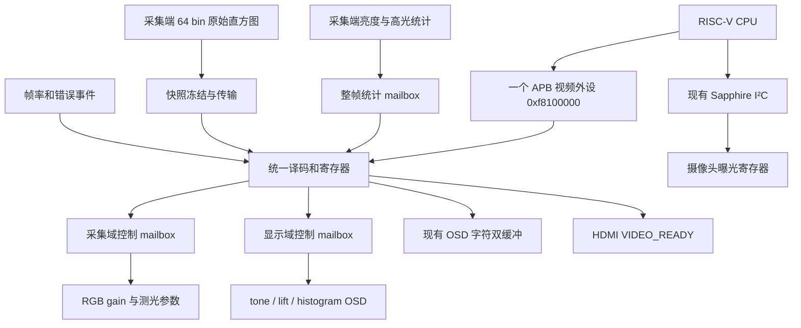

# 单 APB 视频控制与软件 AE 详细方案

日期：2026-10-08。本文为待实施方案，不代表新增控制寄存器或软件 AE 已实现。当前实际实现以 `rtl/soc_integration/osd_apb_regs.sv` 为准：地址偏移 `0x000～0x030` 已有 OSD、VIDEO_READY、帧率和状态，其余下文地址均为规划。

## 1. 目标和边界

保持 Sapphire 对外的一个视频 APB 从接口，基地址 `0xf8100000`；预留低 4 KiB 作为统一控制窗口。本期使用 `0x000～0x17f`，高地址不得与低地址产生别名。新增 ISP/显示/AE/直方图/诊断寄存器不增加 APB 从端口，也不要求重新生成 SoC。

合并地址译码、寄存器读写及软件驱动；像素算法仍独立。CSI、Debayer、gain、resize、DDR DMA、CVO、tone、lift、histogram、OSD 和 HDMI 编码继续按原流水线连接。像素数据及整帧访问保持原有 AXI/DDR 路径。

控制总线不与像素吞吐互相等待。APB 事务不会等待一个视频帧才完成；等待帧边界或直方图传输通过 BUSY/ACK 查询。

Sapphire 内部 I²C 控制器继续使用自己的 MMIO 地址，控制摄像头曝光/VTS/gain。软件 AE 参数存在 CPU 内存中，不为每个软件算法变量增加硬件寄存器。PLL、DDR PHY、CVO 时序、缩放尺寸本期保持静态配置。

## 2. 结构

两个参数控制方向：`core_clk → vid_clk_dvi2` 和 `core_clk → hdmi_tx_slow_clk`。采集统计方向：`vid_clk_dvi2 → core_clk`。CSI 错误来自 `i_mipi_rx_pclk` 域，必须按事件/电平性质分别处理 CDC。

## 3. 寄存器布局

所有寄存器 32 位、4 字节对齐。下表为基地址内的字节偏移。RO=只读；RW=普通读写；CMD=写命令，读回 0。未定义地址、非对齐访问和 RO 写入返回 PSLVERR，且没有副作用。保留位写 0、读 0。现有 APB3 无 byte strobe，仅支持完整 32 位传输。

### 3.1 保留现有接口：0x000～0x030

| 偏移 | 名称 | 类型 | 约定 |
|---|---|---|---|
| 0x000 | LEGACY_ID | RO | 保持 `0x4f534431` |
| 0x004 | OSD_ENABLE | RW | bit0，保持现有兼容语义 |
| 0x008 | OSD_X | RW | 低12位 |
| 0x00c | OSD_Y | RW | 低12位 |
| 0x010 | OSD_COLOR | RW | 低24位 `0xRRGGBB` |
| 0x014 | OSD_CHAR_ADDR | RW | bit7页号，低7位字符地址 |
| 0x018 | OSD_CHAR_DATA | 写入 | 低8位字符，现有读回语义保留 |
| 0x01c | OSD_COMMIT | 写入 | 保留现有提交及 busy/非活动页检查；不重新定义为全局提交 |
| 0x020 | LEGACY_STATUS | RO | 保持 ACK/活动页/busy/FPS低8位/DROP低8位/ERR低8位布局 |
| 0x024 | LEGACY_FPS | RO | 高16位 DISP，低16位 RESIZE |
| 0x028 | VIDEO_READY | RW | bit0=0请求彩条，1允许视频；保留启动门控 |
| 0x02c | RAW_FPS | RO | 低16位 |
| 0x030 | RESIZE_FPS | RO | 低16位 |

不要改动当前 `0x014～0x01c` 驱动协议，旧 ELF 可以继续使用 OSD。新驱动首先检查版本与 capabilities，只有硬件声明存在时才访问扩展地址。

`0x034 VERSION`（RO，建议初版扩展值 `0x00010000`）；`0x038 CAPS`（RO）：bit0基础OSD，bit1启动彩条，bit2帧率诊断，bit3采集参数控制，bit4显示参数控制，bit5软件AE测光，bit6原始直方图快照，bit7完整诊断。未实施功能对应位必须为0。`0x03c EXT_STATUS`（RO）预留全局就绪/复位状态。

### 3.2 RGB gain 与 tone：0x040～0x07f

| 偏移 | 名称 | 类型 | 含义/初值 |
|---|---|---|---|
| 0x040 | RGB_R_SHADOW | RW | 低16位；默认0x0168 |
| 0x044 | RGB_G_SHADOW | RW | 低16位；默认0x0100 |
| 0x048 | RGB_B_SHADOW | RW | 低16位；默认0x01a9 |
| 0x04c | TONE_SHADOW | RW | bit0 enable=1，[15:8]high_green=32，[23:16]dark_red=32 |
| 0x050 | CFG_APPLY | CMD | bit0提交CAPTURE参数组；bit1提交DISPLAY参数组 |
| 0x054 | CFG_STATUS | RO | bit0 CAP_BUSY，bit1 DISP_BUSY，其余位预留 |
| 0x058 | CAP_ACTIVE_SEQ | RO | CAPTURE组在帧边界生效后递增 |
| 0x05c | DISP_ACTIVE_SEQ | RO | DISPLAY组在帧边界生效后递增 |
| 0x060 | RGB_R_ACTIVE | RO | 当前采集域R增益的ACK镜像 |
| 0x064 | RGB_G_ACTIVE | RO | 当前采集域G增益的ACK镜像 |
| 0x068 | RGB_B_ACTIVE | RO | 当前采集域B增益的ACK镜像 |
| 0x06c | TONE_ACTIVE | RO | 当前显示域tone参数的ACK镜像 |

gain 的数值解释必须复用现有 `rgb_gain_v1` 算法，不在迁移时重定义零值或 unity。写入范围按模块真实支持范围限定，零值若保留现有“回退255”行为，应在驱动中明确注明。

### 3.3 lift：0x080～0x0bf

| 偏移 | 名称 | 类型 | 含义/初值 |
|---|---|---|---|
| 0x080 | LIFT_SHADOW | RW | bit0 enable=1，bit1 auto_enable=0，[15:8]manual_strength=32 |
| 0x084 | LIFT_AUTO_SHADOW | RW | [7:0]target，[15:8]max_strength；初期仅手动模式声明可用 |
| 0x088 | LIFT_ACTIVE | RO | 已生效参数的ACK镜像 |
| 0x08c | LIFT_AUTO_ACTIVE | RO | 已生效自动参数的ACK镜像 |
| 0x090 | DISPLAY_STATS_SEQ | RO | 显示亮度统计序号 |
| 0x094 | DISPLAY_STATS | RO | [7:0]平均亮度，[15:8]实际提亮强度，bit16到上限；有效状态另有bit17 |

这些参数由 `CFG_APPLY.bit1` 与 tone/histogram 显示参数同组提交。自动提亮需要脱离旧 RTL AE 的 ready/limit 状态依赖：软件 AE 决策对外提供 can_lift 或第一期继续关闭自动提亮。不能简单打开现有 `lift_auto_enable` 就声称软件 AE 与自动提亮已协调。

### 3.4 软件 AE 测光：0x0c0～0x0ff

| 偏移 | 名称 | 类型 | 含义 |
|---|---|---|---|
| 0x0c0 | AE_STATS_SEQ | RO | 最新有效测光快照的32位发布序号 |
| 0x0c4 | AE_STATS | RO | [7:0]mean，bit8 hot，[25:16]high_permille，其余0 |
| 0x0c8 | AE_STATS_TIME_LO | RO | 快照到达core域时的64位core tick低32位 |
| 0x0cc | AE_STATS_TIME_HI | RO | 同一快照timestamp高32位 |
| 0x0d0 | AE_STATS_FLAGS | RO | bit0 valid，bit1 capture_fault，bit2 resize_fault，bit3 stats_overrun |
| 0x0d4 | AE_METER_SHADOW | RW | [7:0]high_threshold，默认232；本期测光ROI/采样结构固定 |
| 0x0d8 | AE_FRAME_ID | RO | 该测光帧的采集域frame ID |
| 0x0dc | AE_CFG_SEQ | RO | 该帧使用的CAPTURE参数版本 |
| 0x0e0 | SENSOR_FRAME_SEQ | RO | 原始CSI VS事件累计序号，CDC后更新 |

测光点保留 `ae_meter` 的采集侧RGB位置，在 tone/lift/OSD 前；明确它仍受RGB gain影响。参数在源帧起始锁存，并把使用的CFG版本附到统计上；软件切换白平衡后可以丢弃旧版本数据。

AE_STATS_FLAGS 的故障状态须先同步到core域。SEQ=0和valid=0代表复位后尚无有效数据。坏尺寸/不足采样/overflow的图像不发布有效测光快照；旧快照保留，由timestamp判断过期。不能把保留的上次统计当作本次新帧。

### 3.5 histogram：0x100～0x13f

| 偏移 | 名称 | 类型 | 含义 |
|---|---|---|---|
| 0x100 | HIST_OSD_SHADOW | RW | bit0显示使能，bit[2:1]Y/R/G/B模式；默认不显示 |
| 0x104 | HIST_OSD_ACTIVE | RO | DISPLAY提交后生效值 |
| 0x108 | HIST_CMD | CMD | bit0 ACQUIRE，bit1 RELEASE；不能同时写1 |
| 0x10c | HIST_STATUS | RO | bit0 BUSY，bit1 LOCKED_VALID，bit2 FAULT；bit[9:8]snapshot_source |
| 0x110 | HIST_FRAME_ID | RO | 冻结的原始直方图采集帧ID |
| 0x114 | HIST_SAMPLES | RO | 快照总样本数 |
| 0x118 | HIST_BIN_INDEX | RW | [5:0]bin索引，禁止越界；不自动递增 |
| 0x11c | HIST_BIN_COUNT | RO | 当前索引对应原始计数，建议存储/返回32位 |
| 0x120 | HIST_CFG_SEQ | RO | 快照使用的CAPTURE参数版本 |
| 0x124 | HIST_CAPTURE_SEQ | RO | 完成一次ACQUIRE后递增 |

CPU直方图固定为采集侧Y，64bin，bin编号=`Y[7:2]`；采样位置与AE统计保持一致，第一期只支持全画面固定采样，拒绝未经支持的模式。Y定义复用`(R+2G+B)/4`。采集原始直方图与HDMI绘图直方图是不同统计源，二者不可声称同一帧或同一亮度分布。

当前 `hdmi_frame_histogram` 输出的是相对最高bin归一化的绘图高度，并在计算过程中清除原始counts。CPU需要新增保留的原始counts快照接口，不能仅把`o_height`映射到APB。推荐增加采集侧`ae_histogram64`，或把它作为`ae_frame_stats`的可选计数子模块：重用相同采样有效信号，保留现有HDMI绘图模块给OSD使用。

若第一阶段仅使用平均亮度/高光，保持CAPS.histogram=0，省去整组原始计数存储，软件AE仍可运行。

### 3.6 诊断：0x140～0x17f

| 偏移 | 名称 | 类型 | 含义 |
|---|---|---|---|
| 0x140 | FAULT_STICKY | RO | 综合故障锁存，位定义见下文 |
| 0x144 | DROP_COUNT32 | RO | 保留目前capture_fault上升沿计数语义 |
| 0x148 | AXI_ERROR_COUNT32 | RO | 直接导出桥接器已在core域维护的实际错误计数 |
| 0x14c | UNDERFLOW_COUNT32 | RO | 显示域欠载事件经CDC后的计数 |
| 0x150 | RAW_FRAME_COUNT32 | RO | 原始VS累计事件数 |
| 0x154 | RESIZE_FRAME_COUNT32 | RO | resize完成事件累计数 |
| 0x158 | DISPLAY_FRAME_COUNT32 | RO | CVO VS累计事件数 |
| 0x15c | CSI_ERROR_FLAGS | RO | 同步后的CSI错误锁存 |
| 0x160 | RESET_STATUS | RO | PLL/DDR校准/采集复位/显示复位状态 |

FAULT_STICKY建议bit0 capture_fault，bit1 resize_fault，bit2 underflow_seen，bit3 AXI_error_seen，bit4 CSI_error_seen，bit5 CFG_protocol_fault，bit6 stats_overrun，bit7 histogram_fault。第一期只读，随所属系统复位清零，不提供通过软件清除故障后自动恢复的假象；gearbox/resize当前故障是锁存且需要复位恢复。

原有LEGACY_STATUS的8位DROP/ERR布局保留。完整AXI_ERROR_COUNT32应直接使用bridge计数，而不是把连续计数变化合并为一个上升沿事件。CSI原始错误信号是否逐包pulse或sticky需核对接收IP接口后再实现计数，第一期可只导出明确的锁存标志，不声称统计了每个物理错误。

## 4. 控制参数提交协议

参数分为CAPTURE和DISPLAY两个组，不为每个算法增加一个APB接口，也不为每个参数增加独立CDC。

CAPTURE组：R/G/B gain、AE high_threshold，以及未来采集直方图参数。DISPLAY组：tone、lift、直方图显示模式。OSD字符页保持现有独立COMMIT协议，VIDEO_READY保持现有独立门控。

1. CPU写各SHADOW寄存器。影子值不会立即进入像素链路。
2. CPU先确认对应BUSY=0，再写CFG_APPLY组掩码。
3. core域把整组影子参数拷贝到pending payload并锁住，立即置BUSY。BUSY时再次APPLY返回PSLVERR，不覆盖旧请求；影子寄存器仍可写，为下一次提交准备。
4. CDC mailbox接收整组参数后，目标域先缓存为pending。只有在本域定义的安全VS帧边界才能更新active寄存器；采集域沿用现有采集VS极性，显示域沿用其有效帧边界。
5. 生效后返回apply-ACK和参数版本，core才清BUSY并更新ACTIVE镜像。mailbox的“收到数据ACK”与“帧边界生效ACK”不是同一事件，需要分开处理。
6. 不同域允许在不同时间生效，分别查询CAP_ACTIVE_SEQ和DISP_ACTIVE_SEQ。不能声称跨DDR的同一画面同时应用了两组参数。

若摄像头不出帧，CAPTURE组持续BUSY；固件按实际帧周期设置timeout并报告未生效，不偷偷在活动图像中强制应用。下一次合法帧到来可以完成原请求。系统复位清pending/BUSY并恢复默认参数；软件超时不等于硬件请求已取消。

默认参数保持当前校准：R=0x168、G=0x100、B=0x1a9，tone enable=1、两强度32，lift enable=1、manual32，自动提亮关闭、直方图显示关闭。VIDEO_READY复位为0，启动彩条继续独立于DDR和CPU。

## 5. 统计发布与直方图快照

### 5.1 小型AE数据：整包mailbox + 序号校验

源域在一帧统计完成时同时锁存mean/high_permille/hot/frame ID/config版本；整包保持直到CDC确认。目标core域一次性发布payload和SEQ。若源域无法接受新包，保留已提交包并设置overrun，不能把新数值写进仍在跨域的payload。

CPU流程：读SEQ1 → 读stats/flags/timestamp/frame ID/config版本 → 读SEQ2；只有SEQ1=SEQ2且valid=1才接受，否则重读。与上次SEQ相同则不重复调整曝光。timestamp为到达core域时间，可用于老化检查，不宣称精确传感器曝光时刻。

SEQ每发布一次有效统计递增；计算帧周期/判断N+2生效应使用源FRAME_ID/SENSOR_FRAME_SEQ，不能用可能跳过统计帧的发布序号直接代替真实帧号。

### 5.2 完整64bin：冻结快照后读取

ACQUIRE仅在BUSY=0且LOCKED_VALID=0时接受。请求到达采集域后，等下一张完整有效统计帧结束，冻结该帧64bin、samples、frame ID和config版本。冻结数据不会被后续帧覆盖，新的实时统计继续运行。

采用逐bin握手传送到core域的snapshot RAM，或经过验证的双时钟RAM快照bank协议；不能对1024/2048位整组数据逐位二级同步，也不能让APB读正在被像素域更新的counts。先传metadata再传64bin，最后整体置LOCKED_VALID。

CPU先等BUSY=0和LOCKED_VALID=1，再通过INDEX/DATA读取64项。DATA返回core域缓存，对同步RAM读采用明确的一个APB wait state或索引预取ready协议；协议固定后由驱动封装。没有快照时读DATA返回PSLVERR。CPU读完写RELEASE，解除快照锁，不自动覆盖CPU正在读取的帧。

最小存储建议：源域实时计数64×16位；源域冻结快照64×16位；core快照64×32位（可压缩成16位、读时零扩展）。若未来改变采样密度使某bin可能超过65535，要升级源计数宽度或饱和并标记无效，不能静默回绕。准确BRAM/LUT占用由综合确认。

CPU停止读取时，快照可以保持锁定，实时统计不中断。无需依靠自动超时覆盖快照；下一次软件初始化主动RELEASE后重新请求。

## 6. 软件 AE 的职责和时序

保留FPGA对像素的统计工作，CPU仅进行曝光决策和I²C事务。第一阶段用mean和高光比例；64bin作为后续分位数/背光测光扩展。避免为可用软件计算替代的target/deadband等变量增加APB寄存器。

软件组成建议：`video_regs.h`统一偏移/字段；`video_ctrl.c`封装参数提交；`video_stats.c`封装一致快照；`camera_ae.c`实现AE状态机；当前OSD驱动保持兼容。

启动时读取实际VTS=`{320e[6:0],320f}`、曝光=`{3e00[3:0],3e01,3e02[7:4]}`，校验VTS和摄像头ID。曝光范围为4～`2×VTS−11`半行，计算使用足够宽的无符号整型，非法VTS直接禁用AE并报告原因。本期只调曝光，不自动改VTS/PLL/gain，避免把AE与12FPS模式调查混合。

CPU持有唯一摄像头I²C所有权；旧RTL AE controller和legacy I²C写路径保持禁用，软件路径通过验证后可删除不再使用的旧决策/控制逻辑。`ae_frame_stats`保留，显示侧提亮统计保留。

按新测光帧执行一次策略，初始target可采用原AE的96，高光阈值232/限制10‰，设置deadband、滤波、步幅限制与生效等待。可以逐项移植旧算法参数，但只在与参考测试一致时声明行为相同。

曝光写入流程：在传感器推荐的帧开始附近，Group Hold `3812=00` → 更新`3e00/01/02`曝光字段且保留保留位 → `3812=30`释放；每次检查NACK/timeout。即使中途失败也尝试释放Group Hold；失败不更新软件“已生效曝光”，恢复/错误策略单独处理。现有Sapphire封装无条件return 0，实施AE前必须改为真实返回总线错误，并读回验证关键配置。

手册说明N帧写入、N+2帧生效，CPU必须依据源帧序号与实际写入时刻等待新曝光生效后的统计，不能连续根据旧画面调整。CPU轮询时晚到下一帧，应把实际写入对应的新帧记录下来。12FPS下一次响应通常受83ms帧周期及两帧生效延迟主导，I²C/算法的几毫秒并非主要部分。

当前main包含阻塞式OSD ACK等待（最多250ms）、每秒DDR scratch测试和串口打印。软件AE不能仅加入每秒统计分支，也不能声称只修改轮询周期便具备确定的毫秒服务延迟。建议采用CLINT驱动的合作式任务：AE每1～5ms检查新统计，OSD提交改为非阻塞状态机，DDR压力测试改为按预算分块执行或诊断模式运行，串口日志限频。CSI frame seq用于调度，外设中断属于后续优化，不为第一阶段增加IRQ依赖。

若多帧无有效统计、capture/resize故障或I²C失败，AE停止新增写入并输出原因；曝光保持最后确认值，必要时走已定义摄像头恢复流程。提亮由独立参数控制，先固定强度，软件AE稳定后再协调自动提亮，避免两个控制回路同时追逐最终显示亮度。

软件AE不承诺把当前RAW/RESIZE约12FPS提高到30FPS。帧率提升要根据实际传感器时钟、模式和VTS另行验证。

## 7. 实施文件和顺序

建议新建一个顶层`video_apb_ctrl.sv`作为唯一APB入口，已有`osd_apb_regs`功能迁入或作为不带外部独立APB接口的内部寄存器子模块。采用一个读数据mux、一个access-qualified写入口，按地址bank产生local write/read使能，不为每个功能重新构造完整APB从接口。

`video_cfg_cdc.sv`负责两组pending/active及apply-ACK；`video_ae_snapshot.sv`负责整帧统计mailbox和core发布；`ae_histogram64.sv`负责采集计数；`video_hist_snapshot.sv`负责ACQUIRE/传输/RELEASE。原算法模块主要增加已提交参数/统计端口，保留数据流水线延迟。

| 阶段 | 修改范围 | 验收结果 |
|---|---|---|
| 1 | 统一APB框架、版本/CAPS、旧映射兼容 | 旧ELF/OSD/启动彩条/RAW诊断行为保持，单一APB入口 |
| 2 | AE_STATS整帧快照、序号/timestamp/frame ID | CPU能稳定读取mean/highlight，无撕裂/旧帧误触发 |
| 3 | CPU I²C错误处理、AE状态机、任务调度 | 合法曝光/Group Hold/N+2生效等待，亮暗变化可收敛 |
| 4 | RGB/tone/lift参数组及帧边界提交 | 多参数完整生效，busy/ACK可追踪，无帧中途变色 |
| 5 | histogram显示控制、64bin采集快照 | CPU读取冻结原始计数，OSD高度与计数用途明确 |
| 6 | 完整故障/计数与资源回归 | 跨域错误统计语义明确，setup/hold及资源满足 |

优先完成2/3以满足“打开软件AE”；完整64bin并非软件AE上线的前置条件。各阶段只声明已经通过的功能，CAPS与实现匹配。

## 8. 验证和资源预算

APB测试：SETUP无副作用、ACCESS一次执行、连续访问、未定义/非对齐地址/只读写PSLVERR、busy重复命令拒绝、复位默认、旧映射兼容。

CDC/控制测试：异步时钟、任意相位复位、源无帧时pending、影子连续修改不覆盖在途payload、同组参数在一帧边界一起应用、收到数据不等于生效ACK、不同域分别完成、不再直接把多位APB值接入像素域。

统计测试：实际帧输入/残帧/尺寸错误、不足样本、mean/hot参考值、seq发布、跨域payload一致、源快照overrun、core读跨更新时重试。原有RAW/RESIZE/DISP及启动彩条回归继续通过。

直方图测试：sum(bin)=samples、单亮度/全黑/全白/渐变/随机分布、bin边界、冻帧读64项期间新帧不中断、busy请求拒绝、release后重新获取、复位和索引越界。不能仅对归一化柱高测试后声称原始histogram通过。

软件测试：运行真实RV32 ELF模型，注入暗/亮/高光、错误ID、VTS非法、曝光越界、I²C NACK/timeout/释放失败、无统计及帧序号回绕；检查曝光步幅、死区、N+2等待及寄存器保留位。收敛算法采用独立参考，避免仅镜像实现。

性能数量级：60FPS时每帧读取几项AE元数据，APB有效数据只有几KiB/s；64bin每项INDEX写+DATA读约512字节，加metadata后60FPS约30KiB/s，不含APB周期开销。100MHz APB负担很小；每个直方图功能使用一对索引/数据寄存器并不会增加APB接口数量。数据量大于几KiB/frame或需整图访问时才考虑AXI DMA。

合并接口节省重复译码和适配逻辑，但不消除每个功能的算法/快照存储成本。以综合后LUT/FF/BRAM/GBUF和时序报告为准，不预先承诺某个资源减少百分比。

硬件验证时按顺序确认启动彩条 → CPU初始化 → APB提交/ACK → AE读回/曝光写入 → 连续RAW/RESIZE/错误统计 → 直方图完整快照。当前会话之前用户要求暂不烧录，该要求持续有效；本文完成后仍不下载硬件。
