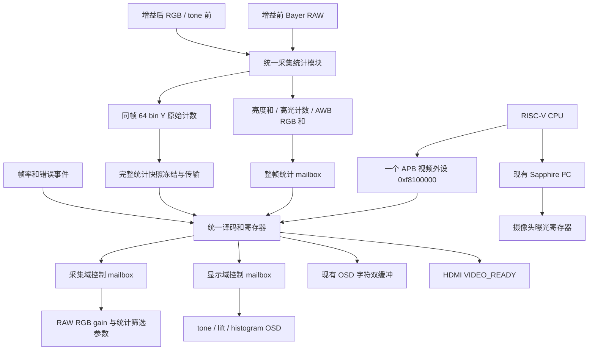

# 单 APB 视频控制与 AE / AWB / 直方图统一统计方案

日期：2026-10-08。原设计方案现已按用户要求进入实际实现：统一 APB、采集 AE/AWB/Y histogram、参数提交与软件 AE/AWB 已接入，实际行为和验证边界见 [实现说明](VIDEO_3A_IMPLEMENTATION.md)。下文保留设计背景；若与实际精度或调度有差异，以实现说明和代码为准。实际采集 RAW 为 gearbox 截取后的 RAW8，软件 AE 使用三个源/采集帧的保守 N+2 等待，自动 lift 继续关闭。实板效果尚未验证。

## 1. 目标和边界

保持 Sapphire 对外的一个视频 APB 从接口，基地址 `0xf8100000`；预留低 4 KiB 作为统一控制窗口。本期使用 `0x000～0x1ff`，高地址不得与低地址产生别名。新增 ISP/显示/AE/AWB/直方图/诊断寄存器不增加 APB 从端口，也不要求重新生成 SoC。实施前核对现有上游地址译码确实覆盖此范围。

合并地址译码、寄存器读写及软件驱动；像素算法仍独立。CSI、Debayer、gain、resize、DDR DMA、CVO、tone、lift、histogram、OSD 和 HDMI 编码继续按原流水线连接。像素数据及整帧访问保持原有 AXI/DDR 路径。

控制总线不与像素吞吐互相等待。APB 事务不会等待一个视频帧才完成；等待帧边界或直方图传输通过 BUSY/ACK 查询。

Sapphire 内部 I²C 控制器继续使用自己的 MMIO 地址，控制摄像头曝光/VTS/gain。软件 AE/AWB 的目标值、滤波、死区、步幅、有效样本门限及增益上限存在 CPU 内存中，不为每个软件算法变量增加硬件寄存器。AWB 通过统一视频 APB 提交现有 RAW R/G/B 增益，不增加摄像头 I²C 写入。PLL、DDR PHY、CVO 时序、缩放尺寸本期保持静态配置。

## 2. 结构



两个参数控制方向：`core_clk → vid_clk_dvi2` 和 `core_clk → hdmi_tx_slow_clk`。采集统计方向：`vid_clk_dvi2 → core_clk`。CSI 错误来自 `i_mipi_rx_pclk` 域，必须按事件/电平性质分别处理 CDC。

统一的是模块、帧号、参数版本、采样坐标规则和快照协议；AE 与 AWB 保留各自的有效样本筛选。AE 的 Y 和、高光计数与直方图严格使用同一批 RGB 样本。AWB 从增益前 RAW 的 Bayer 2×2 单元提取 R、Gr、Gb、B，使用自己的暗部/饱和/中性色筛选，不把筛选后的 AWB 样本数当作 AE 全画面样本数。无需另造一条去马赛克流水线。

## 3. 寄存器布局

所有寄存器 32 位、4 字节对齐。下表为基地址内的字节偏移。RO=只读；RW=普通读写；CMD=写命令，读回 0。未定义地址、非对齐访问和 RO 写入返回 PSLVERR，且没有副作用。保留位写 0、读 0。现有 APB3 无 byte strobe，仅支持完整 32 位传输。

### 3.1 保留现有接口：0x000～0x030

| 偏移 | 名称 | 类型 | 约定 |
|---|---|---|---|
| 0x000 | LEGACY_ID | RO | 保持 `0x4f534431` |
| 0x004 | OSD_ENABLE | RW | bit0，保持现有兼容语义 |
| 0x008 | OSD_X | RW | 低12位 |
| 0x00c | OSD_Y | RW | 低12位 |
| 0x010 | OSD_COLOR | RW | 低24位 `0xRRGGBB` |
| 0x014 | OSD_CHAR_ADDR | RW | bit7页号，低7位字符地址 |
| 0x018 | OSD_CHAR_DATA | 写入 | 低8位字符，现有读回语义保留 |
| 0x01c | OSD_COMMIT | 写入 | 保留现有提交及 busy/非活动页检查；不重新定义为全局提交 |
| 0x020 | LEGACY_STATUS | RO | 保持 ACK/活动页/busy/FPS低8位/DROP低8位/ERR低8位布局 |
| 0x024 | LEGACY_FPS | RO | 高16位 DISP，低16位 RESIZE |
| 0x028 | VIDEO_READY | RW | bit0=0请求彩条，1允许视频；保留启动门控 |
| 0x02c | RAW_FPS | RO | 低16位 |
| 0x030 | RESIZE_FPS | RO | 低16位 |

不要改动当前 `0x014～0x01c` 驱动协议，旧 ELF 可以继续使用 OSD。新驱动首先检查版本与 capabilities，只有硬件声明存在时才访问扩展地址。

`0x034 VERSION`（RO，建议初版扩展值 `0x00010000`）；`0x038 CAPS`（RO）：bit0基础OSD，bit1启动彩条，bit2帧率诊断，bit3采集参数控制，bit4显示参数控制，bit5软件AE统计和/计数，bit6原始直方图快照，bit7完整诊断，bit8增益前RAW AWB统计。未实施功能对应位必须为0。`0x03c EXT_STATUS`（RO）预留全局就绪/复位状态。本次改动仅修改未实施的扩展规划，不改变现有0x000～0x030接口。

### 3.2 RGB gain 与 tone：0x040～0x07f

| 偏移 | 名称 | 类型 | 含义/初值 |
|---|---|---|---|
| 0x040 | RGB_R_SHADOW | RW | 低16位；默认0x0168 |
| 0x044 | RGB_G_SHADOW | RW | 低16位；默认0x0100 |
| 0x048 | RGB_B_SHADOW | RW | 低16位；默认0x01a9 |
| 0x04c | TONE_SHADOW | RW | bit0 enable=1，[15:8]high_green=32，[23:16]dark_red=32 |
| 0x050 | CFG_APPLY | CMD | bit0提交CAPTURE参数组；bit1提交DISPLAY参数组 |
| 0x054 | CFG_STATUS | RO | bit0 CAP_BUSY，bit1 DISP_BUSY，其余位预留 |
| 0x058 | CAP_ACTIVE_SEQ | RO | CAPTURE组在帧边界生效后递增 |
| 0x05c | DISP_ACTIVE_SEQ | RO | DISPLAY组在帧边界生效后递增 |
| 0x060 | RGB_R_ACTIVE | RO | 当前采集域R增益的ACK镜像 |
| 0x064 | RGB_G_ACTIVE | RO | 当前采集域G增益的ACK镜像 |
| 0x068 | RGB_B_ACTIVE | RO | 当前采集域B增益的ACK镜像 |
| 0x06c | TONE_ACTIVE | RO | 当前显示域tone参数的ACK镜像 |

gain 的数值解释必须复用现有 `rgb_gain_v1` 算法：Q8.8，0x0100为1倍，乘法右移8位并在RAW位宽饱和。不在迁移时重定义零值或unity。写入范围按模块真实支持范围限定，零值若保留现有“回退255”行为，应在驱动中明确注明；AWB不会提交零增益。

### 3.3 lift：0x080～0x0bf

| 偏移 | 名称 | 类型 | 含义/初值 |
|---|---|---|---|
| 0x080 | LIFT_SHADOW | RW | bit0 enable=1，bit1 auto_enable=0，[15:8]manual_strength=32 |
| 0x084 | LIFT_AUTO_SHADOW | RW | [7:0]target，[15:8]max_strength；初期仅手动模式声明可用 |
| 0x088 | LIFT_ACTIVE | RO | 已生效参数的ACK镜像 |
| 0x08c | LIFT_AUTO_ACTIVE | RO | 已生效自动参数的ACK镜像 |
| 0x090 | DISPLAY_STATS_SEQ | RO | 显示亮度统计序号 |
| 0x094 | DISPLAY_STATS | RO | [7:0]平均亮度，[15:8]实际提亮强度，bit16到上限；有效状态另有bit17 |

这些参数由 `CFG_APPLY.bit1` 与 tone/histogram 显示参数同组提交。自动提亮需要脱离旧 RTL AE 的 ready/limit 状态依赖：软件 AE 决策对外提供 can_lift 或第一期继续关闭自动提亮。不能简单打开现有 `lift_auto_enable` 就声称软件 AE 与自动提亮已协调。

### 3.4 统一采集统计的帧头和 AE 数据：0x0c0～0x0ff

| 偏移 | 名称 | 类型 | 含义 |
|---|---|---|---|
| 0x0c0 | CAP_STATS_SEQ | RO | AE/AWB标量快照共同的32位发布序号 |
| 0x0c4 | AE_Y_SUM | RO | 32位采样Y累加值，CPU计算精确采样均值 |
| 0x0c8 | CAP_STATS_TIME_LO | RO | 快照到达core域时的64位core tick低32位 |
| 0x0cc | CAP_STATS_TIME_HI | RO | 同一快照timestamp高32位 |
| 0x0d0 | CAP_STATS_FLAGS | RO | bit0 AE_VALID，bit1 capture_fault，bit2 resize_fault，bit3 stats_overrun，bit4 AWB_VALID，bit5 arithmetic_overflow |
| 0x0d4 | AE_METER_SHADOW | RW | [7:0]high_threshold，默认232；本期测光ROI/采样结构固定 |
| 0x0d8 | CAP_FRAME_ID | RO | 该统计帧的采集域frame ID |
| 0x0dc | CAP_STATS_CFG_SEQ | RO | 该帧使用的CAPTURE参数版本 |
| 0x0e0 | SENSOR_FRAME_SEQ | RO | 原始CSI VS事件累计序号，CDC后更新 |
| 0x0e4 | AE_SAMPLE_COUNT | RO | 与Y直方图一致的RGB采样像素数量 |
| 0x0e8 | AE_RGB_HOT_COUNT | RO | 任一R/G/B通道达到high_threshold的样本数，一个像素最多计一次 |
| 0x0ec | CAP_STATS_SOURCE | RO | 固定枚举1：AE=增益后RGB，AWB=增益前RAW；未知值驱动拒绝 |

AE测光点保留 `ae_meter` 的采集侧RGB位置，在tone/lift/OSD前，仍受RAW RGB gain影响。AWB使用增益前RAW，定义见3.7。参数在源帧起始锁存，并把使用的CFG版本附到统计上；软件切换白平衡后丢弃旧版本数据。

故障状态须先同步到core域。复位后valid=0代表尚无有效数据；SEQ为32位模计数，回绕到0不能单独判无效。坏尺寸/overflow的帧不发布有效统计；旧快照保留，由timestamp判断过期。AWB候选为0时可以发布AE_VALID=1、AWB_VALID=0的完整快照，不能妨碍AE运行。CPU检查计数非零后计算 `mean=Y_SUM/SAMPLE_COUNT`、`high_permille=1000×RGB_HOT_COUNT/SAMPLE_COUNT`，乘法使用64位；不保留统计模块内的硬件除法器。

### 3.5 histogram：0x100～0x13f

| 偏移 | 名称 | 类型 | 含义 |
|---|---|---|---|
| 0x100 | HIST_OSD_SHADOW | RW | bit0显示使能，bit[2:1]Y/R/G/B模式；默认不显示 |
| 0x104 | HIST_OSD_ACTIVE | RO | DISPLAY提交后生效值 |
| 0x108 | HIST_CMD | CMD | bit0 ACQUIRE，bit1 RELEASE；不能同时写1 |
| 0x10c | HIST_STATUS | RO | bit0 BUSY，bit1 LOCKED_VALID，bit2 FAULT；bit[9:8]snapshot_source |
| 0x110 | HIST_FRAME_ID | RO | 冻结的原始直方图采集帧ID |
| 0x114 | HIST_SAMPLES | RO | 快照总样本数 |
| 0x118 | HIST_BIN_INDEX | RW | [5:0]bin索引，禁止越界；不自动递增 |
| 0x11c | HIST_BIN_COUNT | RO | 当前索引对应原始计数，建议存储/返回32位 |
| 0x120 | HIST_CFG_SEQ | RO | 快照使用的CAPTURE参数版本 |
| 0x124 | HIST_CAPTURE_SEQ | RO | 完成一次ACQUIRE后递增 |
| 0x128 | HIST_META_INDEX | RW | 冻结快照标量索引0～13，越界拒绝 |
| 0x12c | HIST_META_DATA | RO | 与64bin同帧冻结的标量，定义见5.2 |

CPU直方图固定为采集侧Y，64bin，bin编号=`Y[7:2]`；采样位置与AE统计保持一致，第一期只支持全画面固定采样，拒绝未经支持的模式。Y定义复用`(R+2G+B)/4`。采集原始直方图与HDMI绘图直方图是不同统计源，二者不可声称同一帧或同一亮度分布。

当前 `hdmi_frame_histogram` 输出的是相对最高bin归一化的绘图高度，并在计算过程中清除原始counts。CPU需要新增保留的原始counts快照接口，不能仅把`o_height`映射到APB。最终采用统一的 `capture_frame_stats`：同一RGB采样同时累加Y和、样本数、RGB高光数与64bin，不再配置独立AE测光器和独立采集直方图重复取样。保留现有HDMI绘图模块给OSD使用。

Y直方图可近似均值和Y高光分布，但64bin量化不能替代精确Y和，Y高光也不能替代任一RGB通道饱和检测。因此保留Y和、计数与RGB高光计数，CPU负责除法。第一阶段可以在统一模块内关闭64bin功能、保持CAPS.histogram=0；最终合并方案包含64bin。

### 3.6 诊断：0x140～0x17f

| 偏移 | 名称 | 类型 | 含义 |
|---|---|---|---|
| 0x140 | FAULT_STICKY | RO | 综合故障锁存，位定义见下文 |
| 0x144 | DROP_COUNT32 | RO | 保留目前capture_fault上升沿计数语义 |
| 0x148 | AXI_ERROR_COUNT32 | RO | 直接导出桥接器已在core域维护的实际错误计数 |
| 0x14c | UNDERFLOW_COUNT32 | RO | 显示域欠载事件经CDC后的计数 |
| 0x150 | RAW_FRAME_COUNT32 | RO | 原始VS累计事件数 |
| 0x154 | RESIZE_FRAME_COUNT32 | RO | resize完成事件累计数 |
| 0x158 | DISPLAY_FRAME_COUNT32 | RO | CVO VS累计事件数 |
| 0x15c | CSI_ERROR_FLAGS | RO | 同步后的CSI错误锁存 |
| 0x160 | RESET_STATUS | RO | PLL/DDR校准/采集复位/显示复位状态 |

FAULT_STICKY建议bit0 capture_fault，bit1 resize_fault，bit2 underflow_seen，bit3 AXI_error_seen，bit4 CSI_error_seen，bit5 CFG_protocol_fault，bit6 stats_overrun，bit7 histogram_fault。第一期只读，随所属系统复位清零，不提供通过软件清除故障后自动恢复的假象；gearbox/resize当前故障是锁存且需要复位恢复。

原有LEGACY_STATUS的8位DROP/ERR布局保留。完整AXI_ERROR_COUNT32应直接使用bridge计数，而不是把连续计数变化合并为一个上升沿事件。CSI原始错误信号是否逐包pulse或sticky需核对接收IP接口后再实现计数，第一期可只导出明确的锁存标志，不声称统计了每个物理错误。

### 3.7 AWB 统计与筛选：0x180～0x1ff

| 偏移 | 名称 | 类型 | 含义 |
|---|---|---|---|
| 0x180 | AWB_R_SUM | RO | 候选Bayer 2×2单元中增益前R的32位累加值 |
| 0x184 | AWB_G_SUM | RO | 同一批单元中Gr+Gb的32位累加值，包含两份绿色样本 |
| 0x188 | AWB_B_SUM | RO | 同一批单元中增益前B的32位累加值 |
| 0x18c | AWB_CELL_COUNT | RO | 被接受的完整2×2单元数N；R/B各N样本，G为2N |
| 0x190 | AWB_FILTER_SHADOW | RW | bit0中性色筛选使能，复位0；[15:8]dark_min=8，[23:16]sat_max=248，阈值按8位归一化RAW定义 |
| 0x194 | AWB_NEUTRAL_SHADOW | RW | [15:0]max/min比例上限，Q8.8，建议初值0x0200（2倍，宽筛选） |
| 0x198 | AWB_FILTER_ACTIVE | RO | CAPTURE提交后生效的筛选参数ACK镜像 |
| 0x19c | AWB_NEUTRAL_ACTIVE | RO | CAPTURE提交后生效的中性色比例ACK镜像 |
| 0x1a0 | AWB_TOTAL_CELLS | RO | 筛选前抽样单元数，供CPU计算候选比例 |

未分配地址保持未定义。AWB值与3.4标量共用CAP_STATS_SEQ/帧号/配置版本，无独立AWB发布序号；CPU必须把两组数据作为同一个快照读取。

选择RAW抽样坐标并按已验证BGGR相位拼出完整2×2单元，只保存被抽样列的上一行数据，不新增全幅RAW帧缓存。Gr/Gb先各自做暗部/饱和检查；四个原始样本均满足阈值才进入候选。阈值比较用归一化8位RAW（RAW10在gearbox右移2位得到RAW8），SUM保留gain前RAW精度（实际gearbox输出8位）。端点包含关系固定为 `dark_min <= sample8 < sat_max`；APPLY校验 `0 < dark_min < sat_max <= 255` 和 `neutral_ratio >= 0x0100`，不合法返回PSLVERR。

可选中性色筛选使用当前生效gain计算候选校正颜色：R×gain_R、((Gr+Gb)/2)×gain_G、B×gain_B；比较使用足够宽且未饱和的定点乘积，绿色半值用交叉乘法处理以免过早截断。以 `max×256 <= min×neutral_ratio` 判断，不做硬件除法。这里只用于候选筛选，累加仍是增益前RAW。复位先关闭中性色筛选，CPU依据有效样本与收敛情况选择是否开启，避免初始偏色造成无样本。

AWB RAW单元和AE RGB样本共用帧坐标规则，但因去马赛克延迟和不同筛选，二者不要求COUNT相等。统一模块要对齐RAW/RGB帧号和配置标签，等待两路同帧累加完成后发布；RAW行数据不得跨帧拼接。各SUM采用32位并根据最大抽样数证明不溢出；密度扩展超出范围必须升级位宽或标记无效，不能回绕。

## 4. 控制参数提交协议

参数分为CAPTURE和DISPLAY两个组，不为每个算法增加一个APB接口，也不为每个参数增加独立CDC。

CAPTURE组：R/G/B gain、AE high_threshold、AWB暗部/饱和阈值、中性色筛选使能与比例。采样结构和64bin划分第一期固定。DISPLAY组：tone、lift、直方图显示模式。OSD字符页保持现有独立COMMIT协议，VIDEO_READY保持现有独立门控。

1. CPU写各SHADOW寄存器。影子值不会立即进入像素链路。
2. CPU先确认对应BUSY=0，再写CFG_APPLY组掩码。
3. core域把整组影子参数拷贝到pending payload并锁住，立即置BUSY。BUSY时再次APPLY返回PSLVERR，不覆盖旧请求；影子寄存器仍可写，为下一次提交准备。
4. CDC mailbox接收整组参数后，目标域先缓存为pending。只有在本域定义的安全VS帧边界才能更新active寄存器；采集域沿用现有采集VS极性，显示域沿用其有效帧边界。
5. 生效后返回apply-ACK和参数版本，core才清BUSY并更新ACTIVE镜像。mailbox的“收到数据ACK”与“帧边界生效ACK”不是同一事件，需要分开处理。
6. 不同域允许在不同时间生效，分别查询CAP_ACTIVE_SEQ和DISP_ACTIVE_SEQ。不能声称跨DDR的同一画面同时应用了两组参数。

若摄像头不出帧，CAPTURE组持续BUSY；固件按实际帧周期设置timeout并报告未生效，不偷偷在活动图像中强制应用。下一次合法帧到来可以完成原请求。系统复位清pending/BUSY并恢复默认参数；软件超时不等于硬件请求已取消。

默认参数保持当前校准：R=0x168、G=0x100、B=0x1a9，tone enable=1、两强度32，lift enable=1、manual32，自动提亮关闭、直方图显示关闭。VIDEO_READY复位为0，启动彩条继续独立于DDR和CPU。

## 5. 统计发布与直方图快照

### 5.1 AE/AWB 标量：共同的整包 mailbox + 序号校验

源域在同一帧RAW/RGB统计均完成时，同时锁存Y_SUM/SAMPLE_COUNT/RGB_HOT_COUNT、AWB_R/G/B_SUM/CELL_COUNT/TOTAL_CELLS、有效标志、frame ID/config版本；整包保持直到CDC确认。目标core域一次性发布payload、timestamp和SEQ。若源域无法接受新包，保留已提交包并设置overrun，不能把新数值写进仍在跨域的payload。

CPU流程：读SEQ1 → 读AE/AWB全部标量、flags/timestamp/frame ID/config版本 → 读SEQ2；只有SEQ1=SEQ2才接受，并分别检查AE_VALID/AWB_VALID及各自非零计数，否则重读或跳过对应算法。与上次SEQ相同则不重复调整曝光/白平衡。一次读取应远短于32位序号的完整回绕周期。timestamp为到达core域时间，可用于老化检查，不宣称精确传感器曝光时刻。

SEQ每发布一次有效统计递增；计算帧周期/判断N+2生效应使用源FRAME_ID/SENSOR_FRAME_SEQ，不能用可能跳过统计帧的发布序号直接代替真实帧号。

### 5.2 完整64bin：冻结快照后读取

ACQUIRE仅在BUSY=0且LOCKED_VALID=0时接受。请求到达采集域后，等下一张完整AE有效统计帧结束且同帧AWB完成，冻结该帧64bin和完整AE/AWB标量；AWB_VALID=0仍可完成请求。冻结数据不会被后续帧覆盖，新的实时统计继续运行。

采用逐bin握手传送到core域的snapshot RAM，或经过验证的双时钟RAM快照bank协议；不能对1024/2048位整组数据逐位二级同步，也不能让APB读正在被像素域更新的counts。先传metadata再传64bin，最后整体置LOCKED_VALID。

CPU先等BUSY=0和LOCKED_VALID=1，再通过INDEX/DATA读取64项。DATA返回core域缓存，对同步RAM读采用明确的一个APB wait state或索引预取ready协议；协议固定后由驱动封装。没有快照时读DATA返回PSLVERR。CPU读完写RELEASE，解除快照锁，不自动覆盖CPU正在读取的帧。

HIST_META_INDEX/DATA读取同帧冻结标量，索引约定如下：0=Y_SUM，1=SAMPLE_COUNT，2=RGB_HOT_COUNT，3=AWB_R_SUM，4=AWB_G_SUM，5=AWB_B_SUM，6=AWB_CELL_COUNT，7=AWB_TOTAL_CELLS，8=FLAGS，9=FRAME_ID，10=CFG_SEQ，11=TIME_LO，12=TIME_HI，13=SOURCE。冻结timestamp定义为完整快照到达core域的时间。索引范围外或未LOCKED_VALID时读DATA返回PSLVERR。FLAGS中AE/AWB有效性属于该冻结帧，故障位为冻结时已同步状态。HIST_SAMPLES/FRAME_ID/CFG_SEQ必须与这些标量对应项一致。

实时标量快照可能已经前进到下一帧。需要直方图参与AE计算时，CPU必须使用冻结META中的Y和、高光、样本数及AWB数据，不能混用0x0c0/0x180实时数据。直方图模式由非阻塞ACQUIRE→读取→RELEASE循环驱动；等待/读出不能阻塞I²C和OSD服务，处理较旧帧前仍检查timestamp、源帧进度和配置版本。到达core域的timestamp不包含传输前等待时间，不能仅凭它证明图像新鲜；采集frame ID与CSI序号的对应关系需在集成时验证。

最小存储建议：源域实时计数64×16位；源域冻结快照64×16位；core快照64×32位（可压缩成16位、读时零扩展）。若未来改变采样密度使某bin可能超过65535，要升级源计数宽度或饱和并标记无效，不能静默回绕。准确BRAM/LUT占用由综合确认。

CPU停止读取时，快照可以保持锁定，实时统计不中断。无需依靠自动超时覆盖快照；下一次软件初始化主动RELEASE后重新请求。

## 6. 软件 AE 的职责和时序

保留FPGA对像素的统计工作，CPU通过Y和/计数计算mean、高光比例，仅进行曝光决策和I²C事务。64bin用于分位数/背光测光扩展；标量模式无需等待直方图冻结传输。避免为可用软件计算替代的target/deadband等变量增加APB寄存器。

软件组成建议：`video_regs.h`统一偏移/字段；`video_ctrl.c`封装参数提交；`video_stats.c`封装AE/AWB一致快照及hist冻结读取；`camera_ae.c`实现AE状态机；`camera_awb.c`实现AWB状态机；`camera_3a.c`协调两个回路和配置版本。当前OSD驱动保持兼容。

启动时读取实际VTS=`{320e[6:0],320f}`、曝光=`{3e00[3:0],3e01,3e02[7:4]}`，校验VTS和摄像头ID。曝光范围为4～`2×VTS−11`半行，计算使用足够宽的无符号整型，非法VTS直接禁用AE并报告原因。本期只调曝光，不自动改VTS/PLL/gain，避免把AE与12FPS模式调查混合。

CPU持有唯一摄像头I²C所有权；旧RTL AE controller和legacy I²C写路径保持禁用，软件路径通过验证后可删除不再使用的旧决策/控制逻辑。采集侧`ae_frame_stats`由统一`capture_frame_stats`替代，保留其采样/Y定义和高光语义，移除原mean/high_permille统计除法器。显示侧提亮统计与绘图直方图继续独立保留，它们是后处理统计。

按新测光帧执行一次策略，初始target可采用原AE的96，高光阈值232/限制10‰，设置deadband、滤波、步幅限制与生效等待。可以逐项移植旧算法参数，但只在与参考测试一致时声明行为相同。

曝光写入流程：在传感器推荐的帧开始附近，Group Hold `3812=00` → 更新`3e00/01/02`曝光字段且保留保留位 → `3812=30`释放；每次检查NACK/timeout。即使中途失败也尝试释放Group Hold；失败不更新软件“已生效曝光”，恢复/错误策略单独处理。现有Sapphire封装无条件return 0，实施AE前必须改为真实返回总线错误，并读回验证关键配置。

手册说明N帧写入、N+2帧生效，CPU必须依据源帧序号与实际写入时刻等待新曝光生效后的统计，不能连续根据旧画面调整。CPU轮询时晚到下一帧，应把实际写入对应的新帧记录下来。12FPS下一次响应通常受83ms帧周期及两帧生效延迟主导，I²C/算法的几毫秒并非主要部分。

当前main包含阻塞式OSD ACK等待（最多250ms）、每秒DDR scratch测试和串口打印。软件AE不能仅加入每秒统计分支，也不能声称只修改轮询周期便具备确定的毫秒服务延迟。建议采用CLINT驱动的合作式任务：AE每1～5ms检查新统计，OSD提交改为非阻塞状态机，DDR压力测试改为按预算分块执行或诊断模式运行，串口日志限频。CSI frame seq用于调度，外设中断属于后续优化，不为第一阶段增加IRQ依赖。

若多帧无有效统计、capture/resize故障或I²C失败，AE停止新增写入并输出原因；曝光保持最后确认值，必要时走已定义摄像头恢复流程。提亮由独立参数控制，先固定强度，软件AE稳定后再协调自动提亮，避免两个控制回路同时追逐最终显示亮度。

软件AE不承诺把当前RAW/RESIZE约12FPS提高到30FPS。帧率提升要根据实际传感器时钟、模式和VTS另行验证。

## 7. 软件 AWB 算法与 AE 协调

### 7.1 起始算法：筛选后的灰度世界

当前固定校准增益R=0x0168、G=0x0100、B=0x01a9作为启动和无有效样本时的回退。AWB以绿色为基准，固定G=1倍，使用增益前RAW累加值求绝对目标增益：

```text
N = AWB_CELL_COUNT
mean_R = R_SUM / N
mean_G = G_SUM / (2*N)        // 包含Gr和Gb，不能忘记除以2
mean_B = B_SUM / N
R_target_Q8 = round(256 * G_SUM / (2 * R_SUM))
G_target_Q8 = 256
B_target_Q8 = round(256 * G_SUM / (2 * B_SUM))
```

代码直接用累加值求比例，避免先截断mean。使用64位中间乘法和明确四舍五入规则；R_SUM/B_SUM为0、AWB_VALID=0、候选过少或候选占比不足时保持最后已确认生效增益。有效样本门限及比例由实测调参，不能只要N>0就控制整幅图像。

公式假定传感器黑电平校正后的残余偏置可忽略，实施前用遮光RAW和灰卡确认。若存在显著通道偏置，CPU先按同一RAW单位计算 `R_SUM-N×black_R`、`G_SUM-N×(black_Gr+black_Gb)`、`B_SUM-N×black_B`，使用有符号宽中间值并拒绝非正结果，再求目标比例；黑电平标定值保存在软件配置中。中性色筛选在这种情况下先关闭，避免硬件仍用未扣偏置颜色误筛，后续扩展硬件校正必须另行明确其参数与CAPS。

硬件暗部/饱和筛选先剔除噪声与颜色比例失真的样本；中性色筛选使用当前校正增益，只决定候选资格，目标仍按增益前RAW计算。第一阶段宽筛选/关闭中性色筛选，收敛后可逐步启用；开启后样本持续不足时可回退宽筛选，须通过统一CAPTURE提交并等待新的配置版本统计。

灰度世界在大面积单色物体、混合光源、缺少中性色场景会误判。候选比例、增益限幅、步幅和冻结降低跳变，但不能保证自动识别物体颜色与光源偏色。保留AWB_OFF固定校准、AWB_AUTO、AWB_LOCK冻结三种软件模式；后续可增加白卡手动校准或经标定的光源先验，不在本期声称具备复杂场景识别。

### 7.2 平滑与帧边界提交

建议初始软件增益范围0.5～4倍（Q8.8为0x0080～0x0400），范围最终由摄像头噪声、动态范围实测确定；先限幅目标，再按 `next=current+(target-current)/4` 平滑。加小死区、单次最大步幅及定点舍入处理，避免低于1 LSB的变化长期卡住或不停提交。当前gain必须取已apply-ACK确认的ACTIVE值，不能取未生效SHADOW。

CPU将R/G/B与当前筛选参数作为一个CAPTURE组写入，统一CFG_APPLY，在RAW源帧边界生效。该边界同时生成配置标签，标签随RAW→RGB流水线延迟传递；不能在RAW帧头更新gain，却给上一帧仍在输出的RGB统计贴上新版本。收到apply-ACK后，AWB/AE都等第一份匹配CAP_ACTIVE_SEQ的新帧统计再做下一次控制。不把可能已经在mailbox中的旧帧用于追调。

若临时选择在增益后RGB上做AWB统计，固定G=1时应改用 `R_target=R_active×G_SUM/R_SUM`、`B_target=B_active×G_SUM/B_SUM`，且必须剔除增益导致的饱和；这不是本方案默认数据源。驱动依据CAP_STATS_SOURCE拒绝不匹配数据，不能混用绝对目标公式和反馈公式，也不能从已截断RGB除回原始RAW。

### 7.3 两个控制回路的调度

AE控制传感器曝光，AWB控制RAW颜色增益；tone/lift保持固定，避免三个回路共同追逐显示亮度。启动先完成摄像头初始化并保持固定白平衡，让AE取得可信统计；曝光大幅调整或尚处N+2等待期时暂缓AWB。曝光稳定后允许每帧评估AWB，通过死区/步幅决定是否提交。

单次处理同一快照时，若AWB决定提交增益，暂缓该轮AE写入；等新gain版本的有效测光帧再评估AE。AE写入后AWB等待曝光生效后的统计，已有N+2等待状态同时约束AWB。曝光实际写入和CAPTURE提交均由`camera_3a`统一协调，避免一个快照触发两个大幅变化；增加曝光死区和AWB更新限频，防止小幅AWB变化长期阻碍AE。N+2使用摄像头源帧事件并考虑已确认的采集延迟，不能把统计到达时刻当作曝光生效时刻。

标量模式下每份新快照最多评估一次，CPU只做几个64位运算和除法，无需传输图像。约12FPS时帧周期约83ms；AWB数字gain可在下一合法帧边界生效，颜色稳定还取决于多帧平滑及AE协调，不承诺固定收敛时间。没有有效统计、故障或超时时保持最后确认增益并报告原因，不重新放开启动门控绕过初始化。

## 8. 实施文件和顺序

建议新建一个顶层`video_apb_ctrl.sv`作为唯一APB入口，已有`osd_apb_regs`功能迁入或作为不带外部独立APB接口的内部寄存器子模块。采用一个读数据mux、一个access-qualified写入口，按地址bank产生local write/read使能，不为每个功能重新构造完整APB从接口。

`video_cfg_cdc.sv`负责两组pending/active及apply-ACK；`capture_frame_stats.sv`为统一采集统计入口，内部RAW AWB抽样与RGB AE/hist累加共享帧调度、配置标签和完成状态；`video_stats_snapshot.sv`负责整包AE/AWB标量mailbox和core发布；`video_hist_snapshot.sv`负责完整统计快照的ACQUIRE/传输/RELEASE。64bin累加可以是内部子模块，但不新增独立采样器/APB入口。原算法模块主要增加已提交参数/RAW抽样和配置标签端口，保留数据流水线延迟。

| 阶段 | 修改范围 | 验收结果 |
|---|---|---|
| 1 | 统一APB框架、版本/CAPS、旧映射兼容 | 旧ELF/OSD/启动彩条/RAW诊断行为保持，单一APB入口 |
| 2 | 统一统计模块、AE和/计数、RAW AWB累加、整包序号/timestamp/frame ID | CPU稳定读取同帧AE/AWB，无撕裂，均值/高光由CPU计算 |
| 3 | CPU I²C错误处理、AE状态机、任务调度 | 合法曝光/Group Hold/N+2生效等待，亮暗变化可收敛 |
| 4 | RGB/筛选/tone/lift参数组及帧边界提交 | RAW生效与RGB标签对齐，多参数完整生效，busy/ACK可追踪 |
| 5 | CPU AWB算法、AE/AWB协调、固定/自动/锁定模式 | 白卡与光源变化可收敛，单色/样本不足有回退，旧版本不追调 |
| 6 | 统一模块内64bin、完整冻结快照与hist显示控制 | sum(bin)=AE样本数，冻结AE/AWB标量与64bin同帧 |
| 7 | 完整故障/计数与资源回归 | 跨域错误统计语义明确，setup/hold及资源满足 |

优先完成2/3以满足软件AE；完整64bin并非软件AE上线的前置条件。AWB启用必须在统计、参数提交与协调流程通过之后。最终包含同一模块的AE/AWB/hist全部输出。各阶段只声明已经通过的功能，CAPS与实现匹配。

## 9. 验证和资源预算

APB测试：SETUP无副作用、ACCESS一次执行、连续访问、未定义/非对齐地址/只读写PSLVERR、busy重复命令拒绝、复位默认、旧映射兼容。

CDC/控制测试：异步时钟、任意相位复位、源无帧时pending、影子连续修改不覆盖在途payload、同组参数在一帧边界一起应用、收到数据不等于生效ACK、不同域分别完成、不再直接把多位APB值接入像素域。

统计测试：实际帧输入/残帧/尺寸错误、不足样本、Y和/样本数/RGB高光计数独立参考值、seq发布与回绕、跨域AE/AWB整包一致、源快照overrun、core读跨更新时重试。特别覆盖单通道饱和但Y不高的像素，证明高光计数不能由Y histogram替代。原有RAW/RESIZE/DISP及启动彩条回归继续通过。

AWB硬件测试：已验证BGGR相位、Gr/Gb计数倍数、不同暗/饱和阈值、中性色比例端点、关闭筛选、0候选、单色/中灰/偏色白卡、最大累加值、RAW上一行缓存不跨帧。抽样使用独立坐标参考；增益更新与去马赛克流水线尾部重叠时，RAW/RGB同帧标签仍一致。AWB_VALID=0不阻碍AE快照和hist冻结完成。

直方图测试：sum(bin)=samples、单亮度/全黑/全白/渐变/随机分布、bin边界、冻帧读64项期间新帧不中断、busy请求拒绝、release后重新获取、复位和索引越界；冻结META与直方图同帧，实时标量更新不修改冻结标量，AWB无效帧仍可冻结AE直方图。不能仅对归一化柱高测试后声称原始histogram通过。

软件测试：运行真实RV32 ELF模型，注入暗/亮/高光、错误ID、VTS非法、曝光越界、I²C NACK/timeout/释放失败、无统计及帧序号回绕；检查曝光步幅、死区、N+2等待及寄存器保留位。收敛算法采用独立参考，避免仅镜像实现。

AWB软件测试：G含两倍样本时目标gain正确、零分母/样本不足保持、增益限幅/平滑/舍入/死区、固定/自动/锁定切换、apply失败或超时不更新确认值、旧CFG帧拒绝、曝光等待时AWB暂停、AWB提交后AE等待匹配版本；长时间微调不会饿死AE服务。硬件上用灰卡/白卡及至少两种光源验证，再检查大面积单色和混合光源场景的误判与冻结行为。

性能数量级：60FPS时每帧读取十余项AE/AWB标量及SEQ，APB有效数据只有几KiB/s；64bin每项INDEX写+DATA读约512字节，加冻结META后60FPS约40KiB/s，不含APB周期开销。100MHz APB负担很小；标量扩展和直方图索引/数据寄存器均不增加APB接口数量。数据量大于几KiB/frame或需整图访问时才考虑AXI DMA。

合并接口节省重复译码和适配逻辑；共用RGB采样避免重复统计，CPU计算均值/比例可移除采集统计除法器。新增AWB需要RAW抽样行缓存、颜色累加器、候选筛选及少量标量CDC存储，完整hist快照仍有独立存储成本。检查双像素同周期落同bin/不同bin的计数冲突与清零预算，不能依靠接口合并假设计数吞吐自动满足。以综合后LUT/FF/BRAM/GBUF和时序报告为准，不预先承诺某个资源减少百分比。

硬件验证时按顺序确认启动彩条 → CPU初始化 → APB提交/ACK → AE读回/曝光写入 → AWB灰卡/光源测试与AE协调 → 连续RAW/RESIZE/错误统计 → 直方图完整快照。当前会话之前用户要求暂不烧录，该要求持续有效；本文完成后仍不下载硬件。
