# 视频接口、时钟和 OSD 插入点

## 现有链路

```mermaid
flowchart LR
  CSI[CSI-2 RX / RAW10] --> DB[Debayer / RGB Gain]
  DB --> FBW[frame_buffer 写 AXI]
  FBW --> DDR[唯一 DDR3 控制器]
  DDR --> FBR[frame_buffer 读 AXI]
  FBR --> CVO[CVO / 1280x720 单像素]
  CVO --> TONE[Tone/Lift]
  TONE --> OSD[OSD 输入: RGB/DE/HS/VS]
  OSD --> DVI[dvi_encoder]
  DVI --> TMDS[TMDS 串行输出]
```

顶层 `rtl/ti60f225_oob_top.v` 中的关键连接如下：

| 信号/实例 | 作用 | 时钟域 |
|---|---|---|
| `rgb_datax2`, `rgb_vs`, `rgb_de` | Debayer 双像素 RGB 输出 | `vid_clk_dvi2`，148.5 MHz |
| `frame_buffer` | 采集写 DDR、显示读 DDR | 写侧 148.5 MHz；读侧 HDMI 像素域 |
| `cvo_axi_inst` | 从 AXI 读出单像素 720p 时序 | `hdmi_tx_slow_clk`，74.25 MHz |
| `display_pixel`, `ch0_vs/hs/de` | 最终视频像素和时序 | `hdmi_tx_slow_clk` |
| `tone_adjustment` / `lift_adjustment` | HDMI 前调色和提亮 | `hdmi_tx_slow_clk` |
| `information_overlay` | 直方图、文字合成 | `hdmi_tx_slow_clk` |
| `dvi_encoder_m0` | RGB/同步转 TMDS | 74.25 MHz像素时钟，内部 5 倍串行 |

## 双像素与单像素关系

- 采集处理域每拍携带两个 RGB 像素，频率 148.5 MHz。
- DDR 以 64/128 位 AXI 突发搬运像素；地址按字节计数，视频帧基址和长度必须按 AXI 数据宽度对齐。
- CVO 在显示域每拍输出一个 `0x00BBGGRR` 像素，频率 74.25 MHz，水平时序为 1280/110/40/220，垂直时序为 720/5/5/20。
- `frame_buffer` 和 CVO 内部 FIFO 是跨时钟边界；OSD 只放在最终单像素域，避免把字符坐标解释成双像素坐标。

## OSD 输入输出契约

OSD 的输入取 `lift_adjustment` 输出：`lift_rdata/lift_gdata/lift_bdata/lift_de/lift_hs/lift_vs`。OSD 必须对五个信号使用同一流水线延迟，并把输出直接送入 `dvi_encoder_m0` 的 `i_rdata/i_gdata/i_bdata/i_de/i_hs/i_vs`。字符绘制只在 `DE=1` 的有效像素区域产生；消隐期间保留原同步信号和黑色/原始 RGB 行为。

## 复位和 CDC 约束

`capture_reset_n` 在 `vid_clk_dvi2` 域释放，`display_reset_n` 在 `hdmi_tx_slow_clk` 域释放。CPU/APB 控制使用握手或 mailbox 跨到显示域，不能把 APB 寄存器位直接组合连接到 OSD 像素逻辑。DDR `cal_done` 是所有 AXI Master 的访问屏障。

