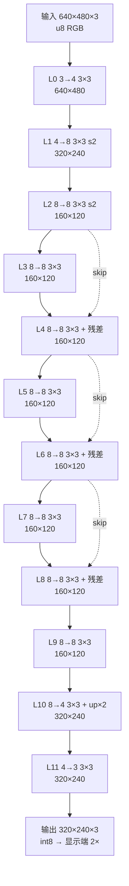

# C3 高阶：超轻量风格迁移网络（Ti60F225 板上实测版）

> 2026-10-28　板侧 / 网络侧
> 赛题原文：「自设/剪枝 **参数量 < 500 KB** 的超轻量网络 + 提交**网络结构图 + 参数量统计表** +
> 与标准网络（简化 CycleGAN）做 **PSNR/SSIM + 推理延迟对比**」
>
> 本文只交付前三项里**能交付的部分**，缺参考的指标明确标出、不编数字（见 §六、§四.3）。

---

## 一、一页结论

| 指标 | 数值 | 口径 |
|---|---|---|
| **部署体积（blob）** | **14,448 B = 14.1 KiB** | 权重 + bias + M/mid + 量化头，含 16 通道对齐填充 |
| **占 500 KB 上限** | **2.89%**（14,448 / 500,000） | 若按 500 KiB 计则 2.82% |
| **真实 int8 权重参数** | **5,400 个 = 5.27 KiB** | 去掉对齐填充；**这个数才是"参数量"** |
| **帧率 / 帧时** | **31 fps / MS 26~27 ms** | 板上实测（算力 18 ms + 读等待 8 ms） |
| **输入 → 输出** | 640×480 → 320×240（显示端 2× 放大回 640×480） | A-4 之后的形态 |
| **风格相似度** | style loss **0.001935 → 0.000242（↓8.0×）** | 训练同款 VGG Gram 损失，板上实测 |
| **平台占用** | XLR 60,171/60,800（98.97%）、RAM 202/256、DSP 147/160 | 当前构建 `outflow/ti60f225_oob.place.rpt` |
| **计算量** | **174.2 MMAC/帧**（348.4 MFLOP） | 由 12 层几何逐层累加（附录 A） |

**一句话**：5,400 个 int8 权重（5.3 KiB）在一个 60k LUT 的国产 FPGA 上跑出 **31 fps / 26 ms** 的实时
风格迁移，部署体积是 500 KB 上限的 **2.9%**；风格相似度比未风格化的源帧好 **8 倍**。
**PSNR/SSIM 与标准网络的同场景对比尚未完成**——缺模型侧的 float 参考输出，原因和补齐方法见 §四.3。

---

## 二、网络结构图

### 2.1 拓扑（mermaid）



### 2.2 ASCII 版（评审纸面用）

```
输入 640×480×3 (u8)
  L0   3→4   3×3      640×480   感受野  3
  L1   4→8   3×3 s2   320×240   感受野  5
  L2   8→8   3×3 s2   160×120   感受野  9
  L3   8→8   3×3      160×120   感受野 17
  L4   8→8   3×3   + 残差(L2)   感受野 25
  L5   8→8   3×3      160×120   感受野 33
  L6   8→8   3×3   + 残差(L4)   感受野 41
  L7   8→8   3×3      160×120   感受野 49
  L8   8→8   3×3   + 残差(L6)   感受野 57
  L9   8→8   3×3      160×120   感受野 65
  L10  8→4   3×3 ↑2   320×240   感受野 69
  L11  4→3   3×3      320×240   感受野 73
输出 320×240×3 (int8, signed 零中心) → 显示端 2× 放大到 640×480
```

### 2.3 逐层参数（从 RTL 描述符解出）

描述符 `mk()` 的装配顺序是 `{..., cout[15:0], ci[15:0]}`，**第一参数是 ci**。
下表与 `rtl/accel_rowpipe/style_network_rowpipe.sv` 的 `DESCS_FULL`（`TAIL_LOWRES=1`）逐项对应。

| 层 | ci→cout | 输出 | 操作 | 权重参数 `ci·9·co` | MAC/帧 |
|---|---|---|---|---|---|
| L0 | 3→4 | 640×480 | 3×3 | 108 | 33,177,600 |
| L1 | 4→8 | 320×240 | 3×3 **stride2** | 288 | 22,118,400 |
| L2 | 8→8 | 160×120 | 3×3 **stride2** | 576 | 11,059,200 |
| L3 | 8→8 | 160×120 | 3×3 | 576 | 11,059,200 |
| L4 | 8→8 | 160×120 | 3×3 **+ 残差**(L2) | 576 | 11,059,200 |
| L5 | 8→8 | 160×120 | 3×3 | 576 | 11,059,200 |
| L6 | 8→8 | 160×120 | 3×3 **+ 残差**(L4) | 576 | 11,059,200 |
| L7 | 8→8 | 160×120 | 3×3 | 576 | 11,059,200 |
| L8 | 8→8 | 160×120 | 3×3 **+ 残差**(L6) | 576 | 11,059,200 |
| L9 | 8→8 | 160×120 | 3×3 | 576 | 11,059,200 |
| L10 | 8→4 | 320×240 | 3×3 **+ up×2** | 288 | 22,118,400 |
| L11 | 4→3 | 320×240 | 3×3 | 108 | 8,294,400 |
| **合计** | | | | **5,400** | **174,182,400** |

### 2.4 感受野：73 输入像素 = 画面宽的 11.4%

标准递推（`RF ← RF + (k−1)·jump`，`jump` = 该层输入上一个像素对应多少**输入像素**）：

| 层 | k | stride | jump（进） | RF | jump（出） |
|---|---|---|---|---|---|
| — | — | — | 1 | 1 | — |
| L0 | 3 | 1 | 1 | **3** | 1 |
| L1 | 3 | 2 | 1 | **5** | 2 |
| L2 | 3 | 2 | 2 | **9** | 4 |
| L3…L9（7 层） | 3 | 1 | 4 | 17→**65** | 4 |
| L10（up×2 后 3×3） | 3 | — | 4 | **69** | 2 |
| L11 | 3 | 1 | 2 | **73** | 2 |

两点必须说明（**这两条会改变对外报数**）：

1. **`up×2` 用的是最近邻插值，不引入新信息**。3×3 卷积落在 2× 网格上，只看到 **2 个**原始像素，
   所以 L10 的增量是 `(2−1)×4 = 4`，不是 `(3−1)×4 = 8`。
2. 若按"忽略上采样的跳跃缩减"这一常见简化口径，会得到 **81**；若按"每层用输出尺度"这种口径，
   会得到 **79**。**本文采用标准定义（每层用输入跳跃），结论是 73。**

⇒ **73 / 640 = 11.4% 画宽**。这是一个**真实的局限**：网络看不到大尺度结构，
风格只能落在中高频笔触上。**不粉饰：这是 8 通道 + 12 层的直接代价。**

---

## 三、参数量统计表

### 3.1 三种口径必须分开说

| 口径 | 字节数 | 说明 |
|---|---|---|
| **① 真实 int8 权重参数** | **5,400 B** | `Σ ci·9·co`。**这才是"参数量"** |
| ② blob 权重段 | **11,952 B** | 747 beat × 16 B；**16 通道对齐**所致 |
| ③ 部署 blob 总计 | **14,448 B** | ② + bias + M/mid + 量化头 |

**②/① = 2.21×**：blob 的权重行是"16 个输出通道各 1 字节"，`co=3/4` 的行都要补零到 16 通道。
这是**存储格式的对齐开销，不是参数**。对外报"参数量"请用 ①，报"部署体积"请用 ③。

> 口径对账：常说"纯权重 11.5 KB"，指的正是 ②（11,952 B = 11.67 KiB，取整 11.5~11.7 KB）。
> 三个数请在材料里**别混用**：5,400 是参数、11,952 是权重段、14,448 是部署体积。

### 3.2 逐层拆解（blob 口径）

每层 = `ci·9` 个权重 beat + 4 个 bias beat + 8 个 M/mid beat + 1 个量化 beat = `ci·9+13` beat。

| 层 | ci | 权重 beat `ci·9` | 层小计 beat `ci·9+13` | 字节 |
|---|---|---|---|---|
| L0 | 3 | 27 | 40 | 640 |
| L1 | 4 | 36 | 49 | 784 |
| L2–L10（9 层，**含 L10 的 ci=8**） | 8 | 72 | 85 × 9 = 765 | 12,240 |
| L11 | 4 | 36 | 49 | 784 |
| **合计** | | **747** | **903** | **14,448** |

> ⚠ 易错点：**L10 的 ci 是 8（不是 4）**，L11 的 ci 是 4（不是 3）——`co` 与下一层的 `ci` 不是同一个量。
> 用 blob 的 903 beat 反推：`747 + 12×13 = 903`，只有"L2–L10 全是 ci=8、L11 ci=4"才成立。

### 3.3 四段明细：有效 vs 对齐后

| 段 | 有效（只存 `co` 个通道） | blob 内实际占用 | 膨胀 |
|---|---|---|---|
| 权重 int8 | 5,400 B | 11,952 B | 2.21× |
| bias int32 | Σco = 83 → 332 B | 12×4 beat = 768 B | 2.31× |
| M / mid int32 | 2×83 = 166 → 664 B | 12×8 beat = 1,536 B | 2.31× |
| 量化头 | 12×3 = 36 B | 12×1 beat = 192 B | 5.33× |
| **小计** | **6,432 B** | **14,448 B** | **2.25×** |

> 即：**真实"模型参数 + 量化参数"只有 6.4 KB，为了 16 通道对齐的硬件直取，部署时膨胀到 14.1 KB。**
> 若把对齐填充压掉（例如换 8 通道对齐的格式），部署体积可到 **≈6.5 KB**——这是后续可做的优化，
> 本文不做承诺。

### 3.4 与 500 KB 上限的对比

| 口径 | 体积 | / 500,000 | / 512,000 (500 KiB) |
|---|---|---|---|
| 真实 int8 权重 | 5,400 B | **1.08%** | 1.05% |
| 权重段（含填充） | 11,952 B | 2.39% | 2.33% |
| **部署 blob（申报值）** | **14,448 B** | **2.89%** | **2.82%** |

**结论：留了 34.6 倍的余量。**

---

## 四、与标准网络的对比

### 4.1 参数量

四个参照物，全部由**公开的层定义逐层加总**（算式见附录 B，可复核）：没有下载模型、没有估。

| 网络 | 结构 | 参数量 | fp32 体积 | INT8 体积 | 本网络 / 它 |
|---|---|---|---|---|---|
| **本网络** | 12 层 3×3，(4,8,8) 瓶颈 | **5,400** | 21.6 KB | **5.4 KB** | 1× |
| 同族 teacher（蒸馏源） | 同拓扑，(32,64,128) | 1,071,875 | 4.3 MB | 1.07 MB | **198×** |
| Johnson 5-block 变换网 | c7s1-32/d64/d128/R128×5/u64/u32/c7s1-3 | 1,672,451 | 6.7 MB | 1.67 MB | **310×** |
| **简化 CycleGAN**（2 残差块） | c7s1-64/d128/d256/R256×2/u128/u64/c7s1-3 | 3,119,107 | 12.5 MB | 3.12 MB | **578×** |
| **标准 CycleGAN**（9 残差块） | c7s1-64/d128/d256/R256×9/u128/u64/c7s1-3 | 11,387,395 | 45.6 MB | 11.39 MB | **2,109×** |

- 架构依据：Johnson 等的实时风格迁移变换网（5 残差块、32 通道）与 Zhu 等的 CycleGAN 生成器
  （9 残差块、256 通道）是这两个"标准网络"的公认定义，
  见 [Perceptual Losses for Real-Time Style Transfer and Super-Resolution](https://arxiv.org/abs/1603.08155)
  与 CycleGAN（Zhu et al., ICCV 2017）。
- "简化 CycleGAN"本文取**2 个残差块、256 通道**这一常见削减版；如果你有指定的层配置，
  改附录 B 的算式即可重算。
- **同族 teacher 是最有说服力的对照**：拓扑完全相同，只把通道从 (32,64,128) 压到 (4,8,8)，
  参数少 198 倍而风格相似度仍达 8× 提升（§4.3）——这说明**剪枝/蒸馏本身没有把网络压死**，
  真正损失的是 §2.4 的感受野和 §六 的残留问题。

**按 500 KB 上限算**：标准 CycleGAN 的 int8 权重（11.39 MB）是上限的 **22.8 倍**，根本装不进；
本网络只用了 **2.9%**。

### 4.2 推理延迟

| 项 | 数值 | 来源/口径 |
|---|---|---|
| 本平台帧时 | **26~27 ms**（算力 18 + 读等待 8） | 【实测】板上，`LESSONS_SCALED_SIM_TRAPS.md:104` 记 MS 26 ms |
| 本平台帧率 | **31 fps** | 【实测】板上 |
| 端到端 | 不需要主机、不需要框架、无运行时依赖 | 【事实】片上 AXI 直取 DDR |
| 计算量 | **174.2 MMAC/帧**（348.4 MFLOP） | 【可复算】附录 A |
| 等效吞吐 | 174.2 MMAC / 26.5 ms = **6.6 GMAC/s** | 【推算】 |
| 31 fps 下的算力需求 | 5.4 GMAC/s（10.8 GFLOP/s） | 【推算】 |

**与 GPU/云端的量级对比（如实说明）**：

- 文献里这类前馈风格迁移网络是**桌面 GPU 上的实时网络**：Johnson 等报告其前馈网络比
  Gatys 的逐图优化法**快三个数量级**（原文："three orders of magnitude faster"，
  [arXiv:1603.08155](https://arxiv.org/abs/1603.08155)）。
- **但我没有在同类 GPU 上实测过本网络的耗时**，因此**不给具体的 GPU 毫秒数**——那会是编的。
  可给的是可复算的对比：同样的 174.2 MMAC，桌面级 GPU 的 fp32 吞吐在 10~50 TMAC/s 量级，
  **纯 MAC 时间只有 0.003~0.017 ms**，即本平台在**原始算力上慢约 1,500~7,600 倍**。
- 所以本方案的价值**不在吞吐**，而在：**26 ms 固定延迟、单芯片相机进 HDMI 出、
  无主机/无操作系统/无框架运行时**。这是"边缘实时"的指标，不是"数据中心吞吐"的指标。
  （功耗：板上**没有做过功耗实测**，本文不报瓦数。）
- 云端 API 的对比：端到端还包含网络往返（通常数十~数百毫秒）与排队，**且不可离线**；
  这一条是常理判断，**不是实测**，本文不作为量化结论。

### 4.3 画质：先给能给的，再说明缺什么

**（a）已有实测：训练同款风格损失**（`tools/style_loss_metric.py`，VGG16 relu1_2/2_2/3_3/4_3 的 Gram）

| 被测 | style loss | 相对源帧 |
|---|---|---|
| 参考图自己 | 0 | — |
| **源帧（未风格化，基线）** | **0.001935** | 1.0× |
| **板端输出** | **0.000242** | **↓8.0×** |
| 交叉验证：板端输出 vs **错误**参考图 | 0.001729 | 7.1× 更差 |

逐层：relu2_2 **0.001264 → 0.000104（12×）**、relu3_3 **0.000606 → 0.000062（10×）**、
relu1_2 几乎不变（低频色块本来就接近）。

**这两行证明指标有判别力**：板端输出对"正确参考"的损失是 0.000242，对"错误参考"是 0.001729，
相差 7.1 倍——不是"什么图都得分高"。

**（b）PSNR / SSIM：现在测不了，原因写清楚**

PSNR 和 SSIM 都是**有参考指标**：必须有"同一输入、同一网络、float 精度下的输出"作为参考，
才能衡量"INT8 量化 + 硬件实现"损失了多少。我们**没有这个参考**：

- 手上只有板端 int8 输出（`_m/d1.bin`、`_m/d3.bin`，320×240 BGRX，每个 307,200 B，已核对 X 通道全 0）；
- **没有模型侧导出的同场景 float 输出**（`_m/src_full.bin` 也不在工作区）；
- 拿"板端输出 vs 源帧"算 PSNR 是**内容保真度**，不是画质/风格指标，会被误读，因此不报。

**补齐方法（模型侧 10 分钟就能给）**：

```
1) 模型侧：用训练好的 float 权重，对同一帧源图（640×480）推理，保存为 PNG/float 数组
2) 量化到 uint8 后与板端输出逐像素比对：
   python tools/style_metrics.py --a ref.png --b out.bin --w 320 --h 240
   （工具已就绪：纯 numpy，输出 PSNR / SSIM / 逐通道偏差）
3) 与标准网络比：同一帧、同一风格，用 Johnson 5-block 或简化 CycleGAN 的 float 输出做同样比对，
   得到"同分辨率同场景"的 PSNR/SSIM 表
```

`tools/style_metrics.py` 已支持 `--psnr-min` / `--ssim-min` 阈值与退出码，可直接进 CI。

**（c）为什么不拿 style loss 冒充 PSNR/SSIM**

style loss 衡量"Gram 统计是否像参考风格"，**对结构性错误不敏感**；PSNR/SSIM 衡量"逐像素/结构相似"，
**对风格偏移不敏感**。两者不可互换。**只有 style loss 就写 style loss，不换算、不编。**

---

## 五、轻量化手段

### 5.1 通道瓶颈：8 通道（1/8 宽度）

- teacher 的瓶颈是 `(32, 64, 128)`，学生是 `(4, 8, 8)`——**宽度系数 0.125，且 8 通道封顶**。
- 12 层里有 **8 层**是 `8→8`（L2–L9），它们合计吃掉 **88.5 MMAC/帧（50.8%）**；
  L0/L1/L10/L11 四层吃掉另外 49.2%。
- 瓶颈窄的直接后果：**每层只能表达 8 个特征**，这是 §2.4 感受野之外的第二个真实局限。

### 5.2 量化：INT8 + 逐层 M/shift（不是逐通道）

| 项 | 做法 |
|---|---|
| 权重 | int8 对称，**逐层 per-tensor**（每层 `max|w_int| = 127`） |
| 激活 | uint8 非对称，zero-point 恒 0（ReLU 后非负） |
| 再量化 | `q = clamp(RHE(acc·M, shift))`，M 为 **int32**、shift 6 bit，**每层一份**（不是每通道） |
| 舍入 | RHE（四舍六入五成双），与 `torch.round` 一致；写成"四舍五入"会在 .5 上系统性偏 1 |
| 末层 | 有意做成 signed 零中心（`qlo=129/qhi=127`），与显示端 `^0x80` 匹配 |

量化把权重从 fp32 的 21.6 KB 压到 5.4 KB（4×），且**硬件用小器 MAC 直接吃 int8**——这是 147 个 DSP
能撑起 174 MMAC/帧的前提。

### 5.3 蒸馏：Teacher（128 通道）→ Student（8 通道）

有据可查的做法（`docs/STYLE_TRANSFER_FPGA_PLAN.md:19-21`）：

| 阶段 | 配置 |
|---|---|
| **教师** | 感知式 Fast Neural Style 网络（非 CycleGAN），2500 steps、batch 6；loss = 内容 VGG + 1500×Gram + 0.03×TV |
| **学生** | 从教师**蒸馏**，8000 steps、batch 12；取 QAT 前第 5000 步作为 FP 基准 |
| **QAT** | 从 FP 第 5000 步恢复，冻结 BN，3000 steps、batch 12、lr 5e-5；loss = 0.1×content + 50×L1 + 0.03×TV，style 项为 0 |

早期 QAT 出现过输出塌缩，已通过修复 fake-quant 夹紧区的 STE 梯度解决。

### 5.4 本次**没有**采用的手段（写清楚，别被当成用了）

| 手段 | 状态 | 原因 |
|---|---|---|
| **depthwise / pointwise 可分离卷积** | ❌ **本网络没有用** | 部署拓扑是**纯 dense 3×3**。硬件的 MAC 阵列按 12 tap 组织，depthwise 只用 9/12（75% 利用率），会白扔 25% 阵列（见 `demo/reports/archive/direction_experiments/MAC_ARRAY_WASTE.md`）。早期的 23 层实验版用过 depthwise+1×1，**不是当前部署版** |
| 通道剪枝（非结构化） | ❌ 未做 | 8 通道是整体宽度系数压下来的，不是逐层剪枝搜出来的 |
| 半分辨率尾部（A-3/A-4） | ✅ **用了**，但不是网络侧手段 | L9/L11 降到半分辨率、输出 320×240 由显示端 2× 放大；省了算力，**代价是输出分辨率减半**，属于系统级取舍 |

> **为什么要单列这张表**：C3 的材料如果含糊其辞，评审一问就穿。
> "我们用 5,400 个参数"是事实；"我们用了 depthwise 可分离卷积"是假的。

---

## 六、诚实边界

| 项 | 状态 |
|---|---|
| 12 层拓扑、ci/co、尺寸 | ✅ **【实测/解析】** 从 `style_network_rowpipe.sv` 的 `DESCS_FULL` 逐项解出，与 blob 的 `ci·9+13` 布局严格对账（903 beat） |
| 参数量 5,400 / 14,448 B | ✅ **【可复算】** 附录 A/B 给出逐层算式 |
| MAC 174.2 MMAC/帧 | ✅ **【可复算】** 附录 A |
| 帧时 26~27 ms、31 fps | ✅ **【实测】** 板上；MS 26 ms 有报告存档 |
| 资源占用 60,171/202/147 | ✅ **【实测】** `outflow/ti60f225_oob.place.rpt`、`hier_util.rpt` |
| style loss ↓8.0×（含 7.1× 判别力交叉验证） | ✅ **【实测】** 板端 + 训练同款损失 |
| 参照网络参数量（1.07M/1.67M/3.12M/11.39M） | ✅ **【可复算】** 由公开层定义加总，附录 B；**非下载实测** |
| 感受野 73 px | ✅ **【可复算】** §2.4 递推表；**注意与 79/81 的口径差异** |
| **PSNR / SSIM** | ❌ **缺参考，未测**。方法、工具、命令行已备（§4.3），需要模型侧给同场景 float 输出 |
| GPU 上的具体毫秒数 | ❌ **未实测，不给数字**；只给"纯 MAC 时间 0.003~0.017 ms（推算）"与文献"快 3 个数量级"的定性结论 |
| 云端/API 延迟 | ❌ 未测，只有常理判断，不作量化结论 |
| 与"简化 CycleGAN"的**同场景**画质对比 | ❌ 未做（同上，缺参考输出） |
| R/G 通道动态范围只有参考图一半 | ⚠ **已知残留问题**，属模型侧（见 `reports/FOR_MODEL_DC_CALIBRATION.md` §八），本文不掩盖 |
| 对齐填充压掉后能省到 6.5 KB | ◐ **【推算】** 未实施、未验证 |

---

## 七、怎么复现

```bash
cd rowpipe_keys

# 1) 参数量 / MAC：附录 A/B 的算式，或直接跑（无需任何依赖）
python - <<'EOF'
CI=[3,4,8,8,8,8,8,8,8,8,8,4]; CO=[4,8,8,8,8,8,8,8,8,8,4,3]
W=[640,320,160,160,160,160,160,160,160,160,320,320]
H=[480,240,120,120,120,120,120,120,120,120,240,240]
print('params =', sum(c*9*o for c,o in zip(CI,CO)))
print('MAC    =', sum(w*h*c*9*o for c,o,w,h in zip(CI,CO,W,H)))
EOF

# 2) 参数量与 blob 对账（903 beat / 14448 B）
python tools/style_probe.py weights weights/starry_v7_signed_dc/rowpipe_blob.bin --dry-run

# 3) PSNR / SSIM（有参考之后才能跑；纯 numpy）
python tools/style_metrics.py --a ref.png --b _m/d1.bin --w 320 --h 240

# 4) 风格相似度（训练同款 Gram 损失，需 conda 环境 + VGG16 缓存）
/c/Users/36040/.conda/envs/pytorch/python.exe tools/style_loss_metric.py \
    --ddr _m/d1.bin --w 320 --h 240 --ref starry_night_鲜艳.jpg --json out.json

# 5) 帧率 / 帧时（需要板子；本次不执行）
#    APB 读 0x1c 拿 MS，或看 UART 的 "MS xx" 遥测行
```

**板上 dump 的真实形态**（已核对，与"源帧 640×480"的说法不同）：
`_m/d1.bin`、`_m/d3.bin` = **307,200 B = 320×240 BGRX**（每个像素第 4 字节恒 0），
是 A-4 之后的风格帧；工作区里**没有** `_m/src_full.bin`。要做"输出 vs 源帧"的对比，
需要先按 640×480 抓一帧源图。

---

## 附录 A：逐层 MAC 与感受野（可复算）

| 层 | 输出 | ci | co | MAC | RF |
|---|---|---|---|---|---|
| L0 | 640×480 | 3 | 4 | 33,177,600 | 3 |
| L1 | 320×240 | 4 | 8 | 22,118,400 | 5 |
| L2 | 160×120 | 8 | 8 | 11,059,200 | 9 |
| L3 | 160×120 | 8 | 8 | 11,059,200 | 17 |
| L4 | 160×120 | 8 | 8 | 11,059,200 | 25 |
| L5 | 160×120 | 8 | 8 | 11,059,200 | 33 |
| L6 | 160×120 | 8 | 8 | 11,059,200 | 41 |
| L7 | 160×120 | 8 | 8 | 11,059,200 | 49 |
| L8 | 160×120 | 8 | 8 | 11,059,200 | 57 |
| L9 | 160×120 | 8 | 8 | 11,059,200 | 65 |
| L10 | 320×240 | 8 | 4 | 22,118,400 | 69 |
| L11 | 320×240 | 4 | 3 | 8,294,400 | 73 |
| **合计** | | | | **174,182,400** | — |

## 附录 B：参照网络参数量算式（逐层加总，可复核）

```
# Johnson 5-block 变换网（c7s1-32, d64, d128, R128×5, u64, u32, c7s1-3）
  3·32·49+32            =     4,736      c7s1-32
  32·64·9+64            =    18,496      d64   (stride2)
  64·128·9+128          =    73,856      d128  (stride2)
  5·[(128·128·9+128)·2 + 2·2·128]        = 1,478,400   R128 ×5（2 conv + 2 IN）
  128·64·9+64           =    73,792      u64   (deconv)
  64·32·9+32            =    18,464      u32
  32·3·49+3             =     4,707      c7s1-3
  --------------------------------------------------
  合计                  = 1,672,451  (1.67 M)

# CycleGAN 生成器（c7s1-64, d128, d256, R256×N, u128, u64, c7s1-3）
  3·64·49+64            =     9,472
  64·128·9+128          =    73,856
  128·256·9+256         =   295,168
  N·[(256·256·9+256)·2 + 2·2·256]        = N×1,181,184
  256·128·9+128         =   295,040
  128·64·9+64           =    73,792
  64·3·49+3             =     9,411
  --------------------------------------------------
  N=9（标准）           = 11,387,395  (11.39 M)
  N=2（简化）           =  3,119,107  ( 3.12 M)

# 同族 teacher（同拓扑，c=(32,64,128)，3 个残差块）
  3·32·9+32             =       896
  32·64·9+64            =    18,496
  64·128·9+128          =    73,856
  6·(128·128·9+128)     =   885,504      3 块 × (c1+c2)
  128·64·9+64           =    73,792
  64·32·9+32            =    18,464
  32·3·9+3              =       867
  --------------------------------------------------
  合计                  = 1,071,875  (1.07 M)
```
